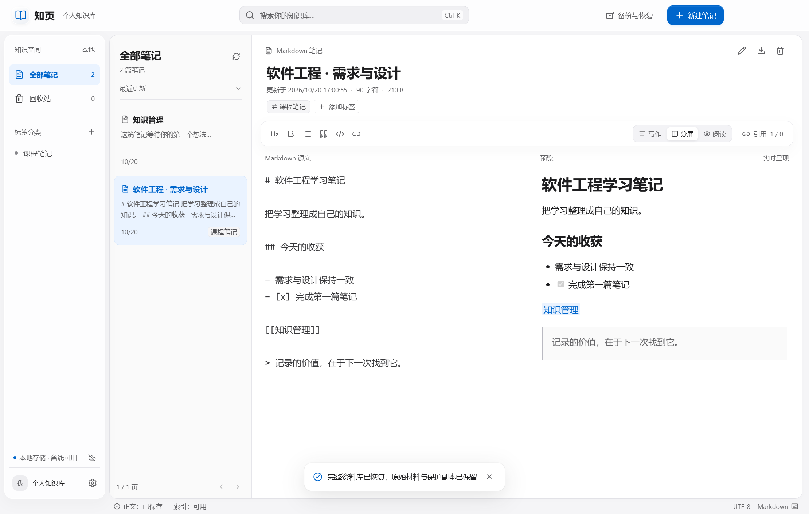
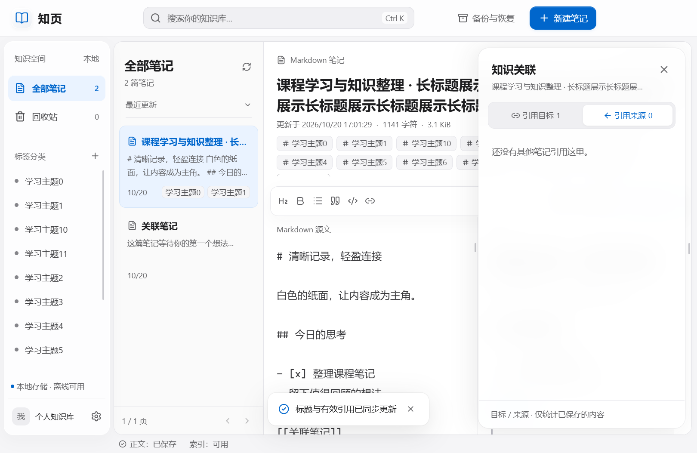

# 1.1.0 视觉改版与退出异常修复

执行日期：2026-10-20。依据本轮用户确认的视觉方案实施，原SRS、SDD及业务数据格式保持不变。

## 1. 改版结果

采用中性白、灰、黑与少量蓝色。白色正文、深色文字与灰色标签替换旧绿灰和棕橙配色；主要操作、链接及选中状态使用蓝色。导航、工具条、分段控件、引用抽屉及弹窗使用窗口内部的半透明白色、背景模糊、亮边与柔和阴影，不依赖桌面壁纸。

顶部整合品牌、搜索、新建及备份入口，使用Electron原生Windows窗口控件覆盖层。导航200px、列表260px；小窗口分别收至176px与232px。正文默认左右分屏，尊重已有模式与字号偏好。辅助界面文字至少12px，正文默认16px。

引用通过工具条的“引用”入口按需打开320px右侧非模态抽屉，不挤压正文。支持目标／来源数量、正反向跳转、Escape关闭与焦点返回；切换笔记后内容更新，回收站明确提示不参与引用。开关只存在于当前会话，不增加偏好字段、数据迁移或业务IPC接口。

设置、标签管理、备份恢复、空状态、故障界面及提示消息采用相同视觉规则。系统要求减少动态效果时取消过渡与进入动画；不支持背景模糊时使用不透明白色。仅交付浅色外观，不启用P2主题或插件。

## 2. 用户报告的JavaScript报错

用户报告开发过程中出现两次JavaScript错误弹窗。诊断实际复现了主进程错误 `TypeError: Object has been destroyed`：窗口已销毁，但索引工作线程的已排队状态消息仍尝试调用旧窗口的webContents。

修复前5轮强制销毁测试中有2轮复现，每轮记录到2次错误框调用；另有5轮正常关闭未复现。原始堆栈保留在[lifecycle-before-fix.json](../reports/lifecycle-before-fix.json)。这是复现到的原因，不将未取得的用户原始弹窗内容编写为已核对证据。

修复措施：发送界面消息前检查窗口及webContents存活状态，收到closed事件后立即解除旧窗口引用；IPC来源检查覆盖已销毁Frame；关闭、显示及第二实例激活使用存活窗口；退出时可选回执确认失败不产生未处理Promise，业务回执仍由数据服务保留。

诊断仅在独立临时测试资料库中将系统错误框转为记录，并监听uncaughtExceptionMonitor，任何捕获到的异常均使检查失败。成品没有通过屏蔽所有JavaScript错误来隐藏问题。修复后记录见[lifecycle-diagnostic.json](../reports/lifecycle-diagnostic.json)。

## 3. 验证口径

- 现有27项核心／集成／容量／安全测试完整回归。
- 桌面测试共6项：原3项功能流程，加1480×940、1080×700两种布局，以及窗口控制、减少动态效果、偏好与关闭前保存兼容。
- 两种尺寸检查空状态、长标题、12标签、长正文、搜索、引用、备份及恢复预检；截图来自真实Electron和合成资料。
- 文字检查通过计算实际前景色与祖先表面颜色的合成值，检查静态可见文字对比度及字号；结果与最低值保留在visual-1480.json、visual-1080.json。这不是对每个动态模糊像素的测量，仍需结合截图检查。
- 退出诊断共10轮，正常关闭及强制销毁各5轮，并发创建20篇合成笔记；与强制结束进程、突然断电测试分别记录。
- 窗口最小化、还原、最大化通过原生窗口API验证；物理鼠标点击原生窗口按钮、拖动边框及拖拽顶栏仍需人工复核。无需据此扩大为硬件或全部平台认证。

最新执行结果以[测试与验收记录](02-测试与验收记录.md)及reports中的日志为准。1.0.0的满容量性能数组保留为历史证据，本轮没有冒充重新执行大型性能基准。

## 4. 截图

