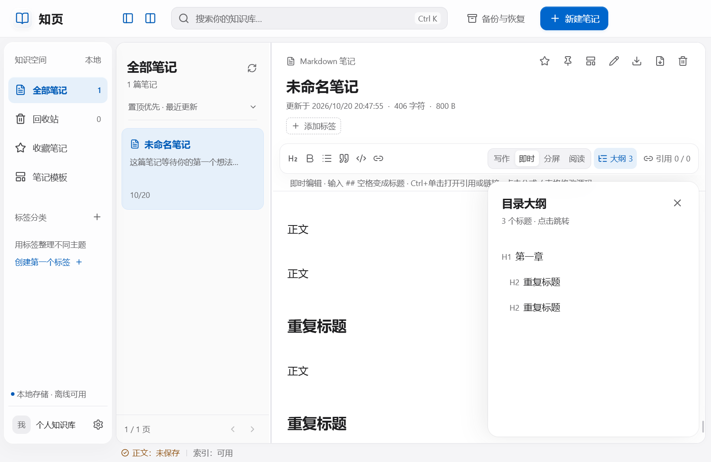
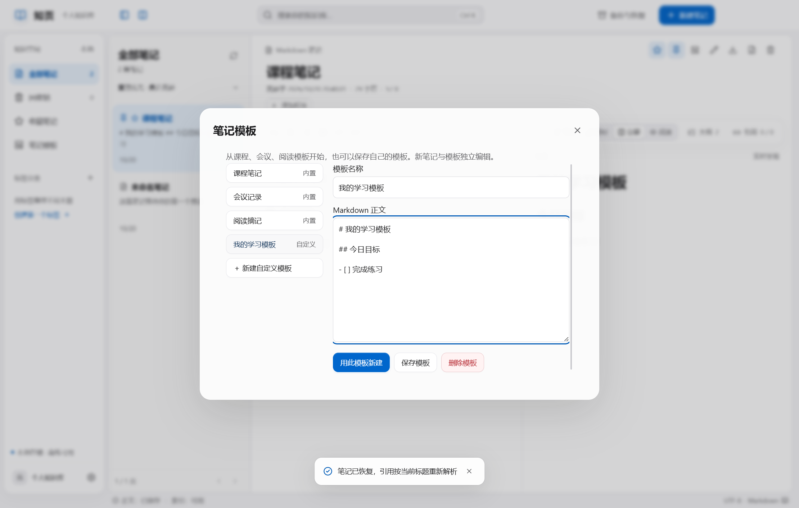
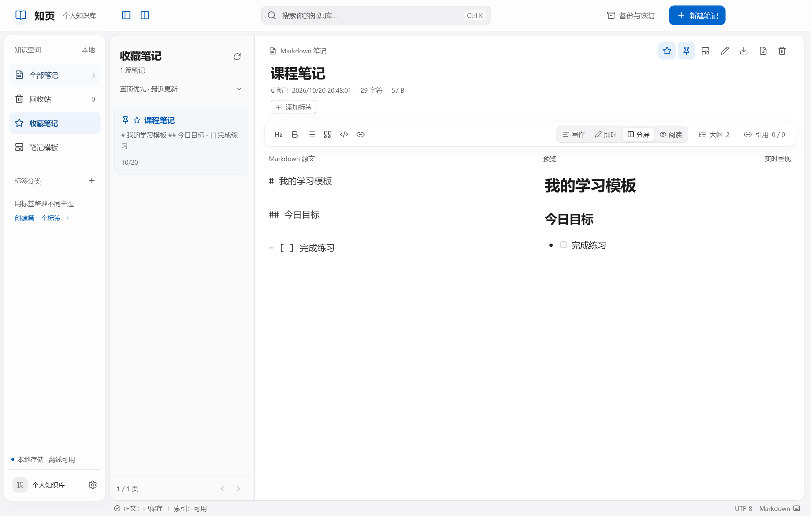
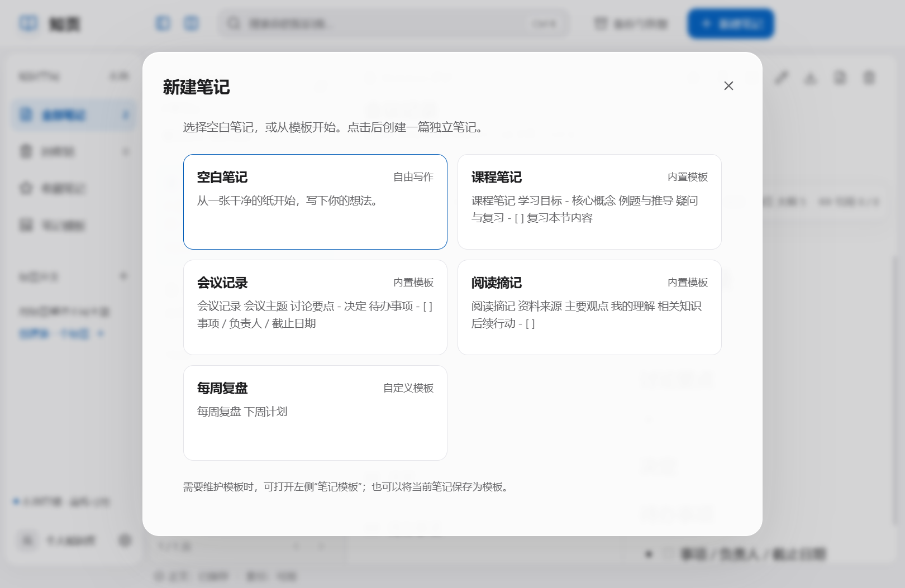

# 知页1.5.0：大纲、引用补全、模板与收藏置顶

## 来源与范围

来源为本次用户请求：“那就先把你推荐的目录大纲、双向引用自动补全、笔记模板和收藏置顶做了，完成后推送GitHub并发布新版release。”本轮是对既有实现的明确追加，不修改实验一SRS和实验二SDD原文、原编号或历史验收结论。保持离线单人使用；不引入云同步、移动端、协作、插件或网络字体。

## 功能及操作

| 追加项 | 入口与行为 | 规则与限制 |
|---|---|---|
| UX-01 目录大纲 | 工具栏“大纲”；按标题层级列出，点击在当前模式跳转 | 支持H1—H6及Setext标题；重复标题按源文位置区分，排除代码块与公式。源码设置光标位置，分屏同时滚动预览，即时编辑滚动到对应位置，阅读模式滚动对应标题 |
| UX-02 引用自动补全 | 在源码或即时编辑输入 `[[`，输入标题片段缩小候选范围 | 最多20条有效笔记，前缀匹配优先，其后按标题键／ID；复用NFC与ASCII大小写规则，`#`、`|`、反斜杠和emoji均按标题字面值处理。上下键选择、Enter插入、Escape关闭，也可单击。输入法组合期间不接管确认键 |
| UX-03 笔记模板 | 左侧“笔记模板”；选择后“用此模板新建”。笔记右上角“保存为模板”保存当前正文 | 内置课程笔记、会议记录、阅读摘记；支持新建／修改／删除自定义模板。模板复制产生独立笔记，不更改已有笔记；同名自动编号。仅复制正文，标签与标记不复制；从1.5.1起，“新建笔记”及Ctrl+N先弹出选择，可选空白、内置或自定义模板 |
| UX-04 收藏与置顶 | 笔记右上角星形和图钉；左侧“收藏笔记” | 两个标记独立。全部、标签与收藏普通列表先置顶，再按更新时间降序、ID排序，先排序后每页50条。收藏可继续搜索及按标签取交集；搜索保持原匹配字段／更新时间排序，回收站保持原更新时间排序 |

大纲与引用抽屉互斥，只在当前界面会话记住开关。大纲不遮挡模式工具栏，Escape关闭并将焦点返回入口。引用补全仅建议已有有效笔记，允许自引用；不会自动创建笔记，不支持别名或锚点语法。代码、公式和奇数反斜杠转义的引用不开启补全；已有紧邻的 `]]` 会复用，避免重复闭合。失焦、只读、弹窗及操作期间隐藏候选；迟到的异步结果不替换当前候选。按Escape关闭后，下一次输入可再次触发。

自定义模板最多50个，单个正文最多64 KiB，正文总计最多256 KiB；名称采用现有笔记标题规范，自定义模板名称不得重复。编辑自定义模板后须先保存才能用于新建，避免复制未保存前的旧内容。内置模板不可编辑或删除，可先新建笔记后另存为自定义模板。模板内容为静态Markdown，不含日期变量或脚本，预览使用既有安全渲染。

收藏、置顶的更新先保存草稿，再按笔记修订号提交；标记操作会更新该笔记的修订号和更新时间。移入回收站时保留标记，收藏视图排除回收站；恢复后重新出现，永久删除时清理标记。标签删除／恢复和按当前标题重新绑定引用的原规则保持不变。

## 数据、事务和备份兼容

复用现有SQLite格式1与本地档案的 `preferences`，增加可选 `favorites`、`pinned`（笔记UUID数组）和 `templates`（template_id、title、content）字段；不改写笔记正文格式、不增加外部服务。数组不允许重复或悬空笔记ID，模板ID必须唯一。模板与标记和业务版本、变更清单、回执一起在事务内提交。新建模板笔记直接写入正文和引用目录，最终仍校验笔记数、正文与引用容量；任何超限或提交前失败整体回滚，不留下空白半成品。

**新版写出的完整备份使用格式2，同时兼容读取格式1。** 两种格式仍严格仅含 `manifest.json` 和 `data.json`，数据中的SQLite业务模式仍为1。格式2在档案偏好中保留新增元数据，维持SHA-256、CRC、UTF-8、重复字段、结构、外键和容量检查；格式1不允许夹带格式2字段。恢复格式1时没有收藏／置顶／自定义模板，不猜测生成；恢复格式2会整体恢复这些内容。旧版本不能读取格式2，请使用1.5.0或后续兼容版本恢复，不建议将已使用新增功能的资料库交给旧版写入。原始备份文件不被升级或覆盖。

| 输出 | 正文 | 标签／标题／时间清单 | 收藏／置顶 | 自定义模板 |
|---|---|---|---|---|
| 单篇Markdown | 是 | 否 | 否 | 否 |
| PDF | 排版后正文及标题 | 否 | 否 | 否 |
| 全部Markdown ZIP | 有效笔记正文 | 是 | metadata.json增加favorite／pinned | 否 |
| 完整备份格式2 | 含回收站 | 是 | 是，含回收站标记 | 是 |

外观图片、颜色、分栏宽度、即时模式本机记忆仍不随业务备份迁移。内置模板定义随程序提供。跨设备迁移仍使用完整备份整体恢复，不能将Markdown导出包作为恢复输入。备份不加密、不自动删除，用户仍需安排独立介质和保留策略。

## 实现追踪与验证依据

| 追加项 | 代码 | 主要验证 |
|---|---|---|
| UX-01 | shared/productivity.ts的outline；renderer/main.tsx；live-editor.tsx的reveal | productivity核心测试；桌面源码／阅读／即时跳转、重复标题、1080窗口 |
| UX-02 | completionContext；note.suggest；renderer/productivity.tsx；live-editor光标接口 | 代码／公式／转义／特殊字符、源码／即时、重复输入、键盘／单击及模拟组合事件 |
| UX-03 | template.list/save/delete、note.create模板参数；TemplateManager | 模板独立副本、同名编号、限额、失败回滚、容量激活拒绝、真实桌面复用 |
| UX-04 | note.flag、Store.list、search.query收藏限定、备份偏好校验 | 幂等、CAS、回收／恢复／清理、跨页排序、标签交集、收藏搜索与重启 |
| 备份升级 | archive.ts格式1／2检查、Store.import | 格式1可读／不得混入新版字段、格式2往返、非法ID拒绝及原资料保留 |

完整结果以[测试与验收记录](02-测试与验收记录.md)、reports/unit-tests.log、reports/desktop-tests.json及reports/packaged-test.json为准。开发阶段的初次备份未知版本测试和桌面交互失败日志另保留为productivity-*.log，不记为通过结果。修复了抽屉挡住模式按钮、已补全的相同前缀无法再次触发、组合输入确认键被编辑快捷键处理的问题；补齐了测试对原生删除确认和恢复对话框的完整操作，并等待即时编辑器实际挂载后再验证跳转。

未组织真实新用户任务或全量Windows输入法人工测试；断电、长期运行预算和新版全容量性能未在本轮重做。历史性能数据继续限定为1.0.0，不能当作1.5.0性能证明。

## 1.5.1新建入口修订

用户反馈：“新建笔记的时候应该弹出模板选择，不然我都找不到模板入口”。新建按钮、空状态入口与Ctrl+N统一打开模板选择弹窗，所有卡片直接创建，空白笔记始终可选；模板管理入口继续用于维护模板。仅打开、关闭或按Escape不会创建笔记；选择后先保存当前草稿，成功创建后关闭弹窗并聚焦编辑器。创建期间防止重复提交并阻止关闭，失败保留选择入口与错误提示。模板内容、限额、容量校验和备份格式沿用1.5.0。

