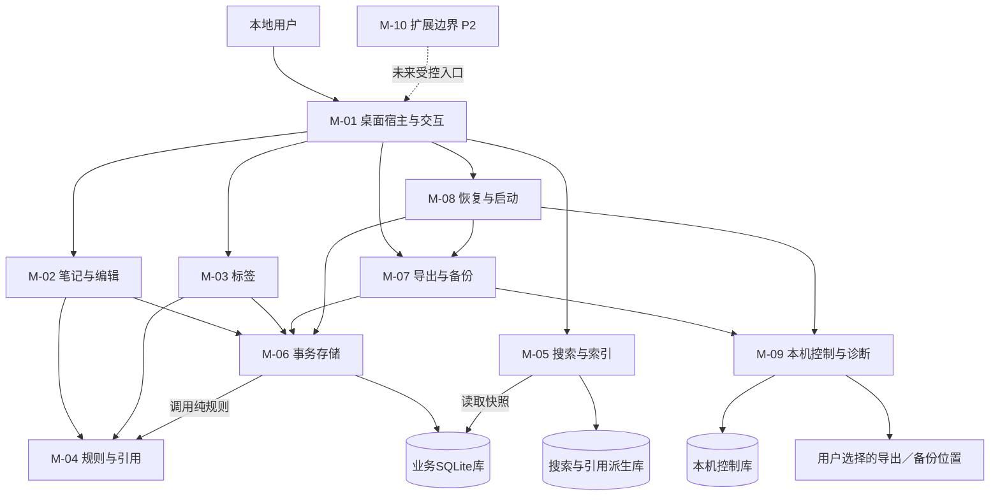
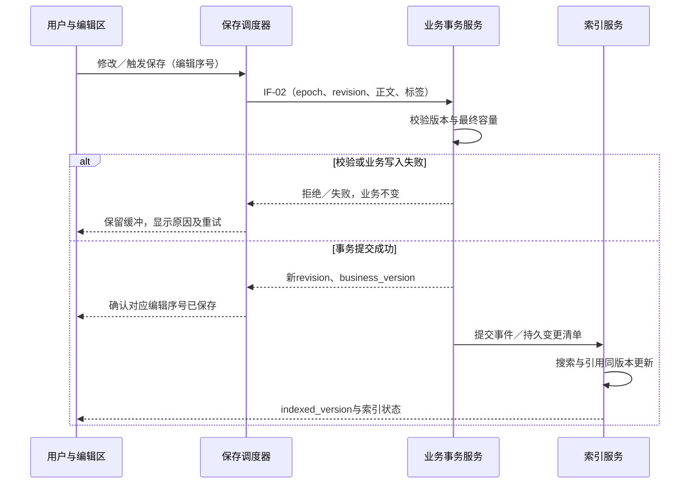
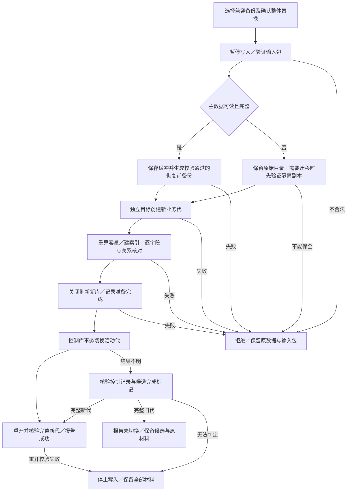
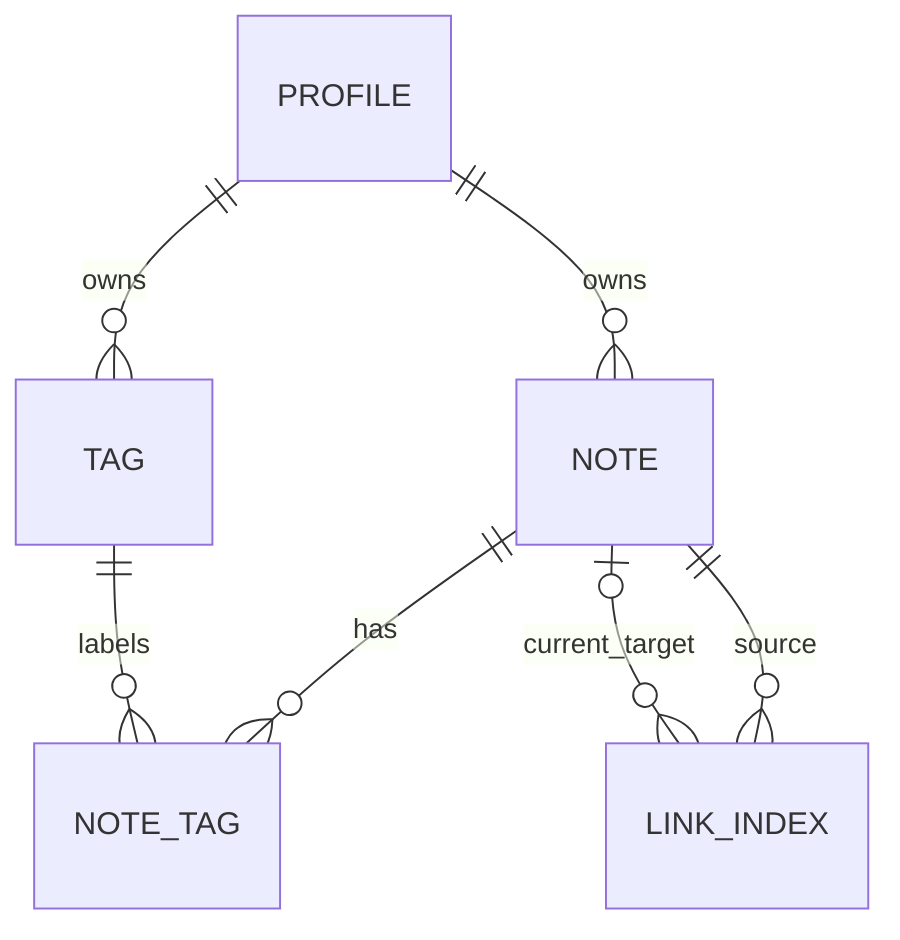

# 个人 Markdown 笔记与知识管理工具软件设计文档

| 文档属性 | 内容 |
|---|---|
| 文档类型 | 软件设计说明书（架构设计与系统设计） |
| 文档版本／日期 | SDD V1.1（设计评审修订版）／2026-10-12 |
| 所属实验 | 软件工程实验二：软件设计文档生成 |
| 需求基线 | 实验一 SRS V1.1（批改补正版，2026-09-28）；原文副本见[需求基线](需求基线/01-需求分析文档.md) |
| 设计范围 | 单用户、单机 Windows、本地资料库；P0、P1完整设计，P2仅预留边界 |
| 状态 | 可供开发与测试准备的设计草案；未实现、未运行软件验收，未替代需求负责人的基线冻结 |

本文沿用实验一全部FR、NFR、BR、AC编号。技术选型、模块与接口是本实验的设计决定，不冒充用户访谈结论。ASM-01—ASM-04继续使用基线已列出的唯一默认方案；其人工确认状态未被改写。本文的性能数值均为待验证目标。

编号约定：AR为架构，M为模块，FL为流程，IF为界面调用接口，IIF为内部接口，D为数据设计，UI为界面，ND为非功能设计，OP为运行预算，EX为异常，ADR为设计决策，TD为设计验证。上述编号不替换原需求编号；术语统一见1.5。

## 一、架构设计

### 1.1 设计目标和约束（AR-01）

系统解决个人笔记分散、分类与搜索困难、知识关联不清和长期保存风险。学生、知识工作者、研究人员是同一个本地权限角色的不同使用群体。建设目标为：离线编辑与分类；可解释的字面搜索与双向引用；可核实的保存状态；可恢复的备份。

基础版实现FR-N01—N07、FR-T01—T05、FR-S01—S04、FR-L01—L04、FR-E01—E04。FR-X01—X03及NFR-S07为P2。本实验不实现应用代码，不增加云同步、移动端、协作、在线账号、附件、Markdown导入、知识图谱或AI内容功能。

运行基线沿用SRS：Windows 10／11 64位、4核CPU、8 GB内存、SSD、本地磁盘、单写入实例；10,000篇笔记（含回收站）、单篇1 MiB、正文合计300 MiB（含回收站）、2,000标签、每篇20标签、100,000条有效有向引用。MiB为1,048,576字节。这里规定测试环境，不代表已核实用户设备。

### 1.2 分层与组件（AR-02）

采用桌面模块化单体。建议技术栈为Electron＋TypeScript＋React界面、SQLite本地存储；不部署HTTP服务。编辑器和Markdown解析器作为适配器接入，须通过本文的语法与安全样例后才能确定具体依赖版本。SQLite构建须提供FTS5 trigram能力。发布前锁定全部依赖版本和离线资源；不在本文虚构已安装版本。

[系统架构图静态图片](设计图/01-系统架构图.png)（阅读器不支持Mermaid时可查看）。



图中每个M编号只代表一个逻辑模块，展示主要调用／数据访问关系；完整依赖见2.1。界面、预加载桥和宿主属于M-01在不同进程中的组成部分，不是三个额外模块。各架构组件的归属如下。

| 架构组件 | 唯一归属模块 | 层次与职责边界 |
|---|---|---|
| 呈现界面、预加载桥、桌面宿主 | M-01 | 交互与入口层：可信来源校验、状态显示、用户操作分发 |
| 笔记编辑、保存调度、回收站用例 | M-02 | 应用层：编排笔记操作 |
| 标签生命周期与关联用例 | M-03 | 应用层：编排标签操作 |
| 字符、容量、Markdown及引用规则内核 | M-04 | 领域层：只产生规则结果或计划，不直接写数据库 |
| 搜索查询、索引更新与重建 | M-05 | 查询／派生层：维护同版本搜索和引用 |
| 业务仓储、写队列及读快照适配器 | M-06 | 存储层：唯一业务写入入口 |
| 导出序列化、备份包及摘要生成 | M-07 | 应用层：管理快照输出任务 |
| 启动、恢复、升级与库代切换协调器 | M-08 | 应用层：管理恢复互斥和切换协议 |
| 受控文件适配器、本机控制库和运行诊断 | M-09 | 基础设施层：文件权限、控制记录和OP预算观测 |
| 版本化扩展描述与能力入口 | M-10 | P2边界：基础版不运行插件 |

依赖方向为呈现→接口→应用→领域／基础设施抽象。M-06在提交前调用M-04校验完整计划，纯规则代码只接收快照、不反向调用仓储。领域逻辑不得访问窗口、文件对话框或任意路径；SQLite、ZIP、系统浏览器经适配器访问。搜索服务只读已发布派生代；写入服务不依赖异步搜索索引来判断容量。备份恢复复用校验器和解析器，避免两套规则。

**个人项目复杂度取舍：**采用一个安装包、一个资料库和进程内／本机消息接口；10个逻辑模块不分别部署为服务，也不新增消息中间件、远程监控或账号系统。保留业务与索引工作进程，是为隔离耗时任务和故障，代价是需要维护版本、任务状态和少量IPC。主数据、派生数据和本机控制数据分别承担不同生命周期；这增加了恢复设计工作，但能落实原需求的数据保护规则。OP观测复用M-09的计时与本地日志，P2运行时后置。

### 1.3 部署与进程视图（AR-03）

| 部署单元 | 职责与权限 | 失败影响 |
|---|---|---|
| 安装包及本地静态资源 | 主进程、界面、依赖和语法帮助随包分发；无需网络启动 | 资源缺失提示修复安装，不初始化空库覆盖数据 |
| 沙箱渲染进程 | 编辑缓冲、预览、列表；无Node与任意文件权限 | 未保存缓冲可能丢失；已提交数据不受影响 |
| 桌面宿主进程 | IPC白名单、可信窗口校验、OS对话框、打开外链、任务协调 | 退出后重新核验活动代与业务版本 |
| 业务工作进程 | 业务数据库唯一写入连接、事务、容量校验、备份快照导出 | 事务完整提交或回滚；不得把未知结果显示为成功 |
| 索引工作进程 | 只读业务快照，写派生库；查询和重建调度 | 搜索／引用暂不可用，编辑与直接查看仍可用 |
| 本机资料目录 | 控制库、业务代目录、派生代、有限运行日志 | 主数据异常进入故障恢复 |
| 用户选择的库外目录 | 独立完整备份ZIP、Markdown导出、可选故障保全副本 | 介质不可用时报告失败，不删除现有数据腾空间 |

只有一个应用实例持有资料目录的OS排他锁。主进程单实例锁和规范化真实路径后的资料库锁同时检查；拒绝通过不同路径别名绕过同库锁。业务库采用SQLite事务、外键校验、WAL和同步等级FULL。WAL不用于网络共享目录，也不声称多个数据库之间天然原子；恢复切换另按FL-06设计。[SQLite WAL说明](https://www.sqlite.org/wal.html)、[同步等级说明](https://www.sqlite.org/pragma.html#pragma_synchronous)

### 1.4 运行与一致性视图（AR-04）

三个版本量不得混同：`epoch`标识当前资料库安装代；`business_version`标识该代每次业务事务；`indexed_version`标识已发布的搜索和引用快照。完整恢复生成新epoch，即便备份中的revision与当前相同，旧请求仍失效。

普通写入先在一个业务事务中提交笔记、关联、版本、容量校验辅助数据及变更清单，再异步更新搜索与引用。仅当epoch一致且indexed_version等于当前business_version时提供当前搜索／引用查询。每次业务提交立即使旧查询令牌失效；正常增量在提交后2秒内发布，重建期间按独立时限执行。

保存状态与索引状态相互独立。“已保存／索引更新中”是合法状态；索引失败不得回滚成功的正文。恢复只有暂存业务数据和索引均验证通过后才允许切换。

### 1.5 集中术语表

| 术语／字段 | 本文的唯一含义 | 规则入口 |
|---|---|---|
| 权威业务数据 | Profile、Note、Tag及NoteTag；引用目标不是历史权威绑定 | 5.2、5.3 |
| epoch／资料库安装代 | 一次被激活的完整资料库身份；恢复生成新epoch | 1.4、4.1.2 |
| revision | 单篇笔记业务版本；编辑冲突校验用，不是全库版本 | 4.1.1、D-02 |
| business_version | 当前epoch内业务事务的单调递增版本 | 1.4、D-05 |
| indexed_version | 搜索和引用共同覆盖的已发布业务版本 | 1.4、FL-04 |
| 快照／ChangeSet | 某一业务版本的一致读取视图／同事务记录的变更集合，后者不保留历史正文 | IIF-04、D-07 |
| 校验目录／派生代 | 提交时的同版本容量辅助数据／可整体替换的查询索引；均可从主数据重算 | D-06、D-08、D-09 |
| request_id／task_id | 一次调用的幂等标识／可跨多阶段查询的后台任务标识 | 4.1.3、4.1.4 |
| accepted／committed／completed | 已接收任务／业务事务已提交／任务已完成；accepted不是成功 | 4.1.3 |
| 路径令牌／确认令牌 | 用户选择位置的用途授权／绑定操作与版本的明确确认 | 4.1.6、4.1.7 |
| NFC／ASCII折叠 | Unicode规范等价归一／仅A—Z转为a—z；不等于NFKC或全语言大小写折叠 | 5.4.1 |
| 码点／UTF-16偏移／UTF-8字节 | 分别用于名称长度／文本位置／容量；不可相互代替 | 5.4.1、5.4.4 |
| 名称键／有效引用／失效引用 | 规范化查找键／可解析到当前有效目标的合法标记／合法但当前无目标的标记 | 5.4.1、5.4.5、5.4.6 |
| 差量闭包 | 未追平提交直接及间接影响的全部去重笔记，含标题激活、删除及标签变化扩散 | OP-01 |
| 发布屏障 | 停止接纳新业务提交到重新开放的完整区间，含等待在途事务 | OP-01 |
| 不可用事件／不可用总时长 | 从首次失去当前可查询索引到重新可用的连续事件／观察窗内事件区间的并集时长 | OP-02 |
| WAL／checkpoint | 业务库预写日志／SQLite将可回写日志页写回主库的过程；不能手工删WAL替代 | OP-03 |
| WAL物理大小／未回写页 | 已分配WAL文件字节／尚未checkpoint的页数；文件大小不等于待回写数据量 | OP-03 |
| 条件性验证／门禁 | 触发迁移、P2等条件后必须执行的验证／允许实现发布前须满足的证据条件 | 10.4 |

## 二、模块设计

### 2.1 模块职责与依赖

| 编号／模块 | 内部结构与责任 | 对外接口 | 依赖／禁止事项 |
|---|---|---|---|
| M-01 桌面宿主与交互 | 窗口、预加载桥、状态订阅、文件选择、实例锁 | IF-01—IF-16，IIF-05 | 调用应用服务；不接受任意通道和SQL |
| M-02 笔记与编辑 | 编辑会话、保存调度、revision校验、回收站、重命名计划 | IF-01—IF-04 | M-04、M-06；不直接改派生索引 |
| M-03 标签 | 名称规范化、全局生命周期、笔记标签集合 | IF-05、IF-06 | M-04、M-06；标签删除包含回收站关联 |
| M-04 规则与引用 | 名称键、语法解析、位置映射、引用计划、完整最终容量校验 | IIF-01、IIF-02 | 纯规则＋业务快照；无UI或任意文件依赖 |
| M-05 搜索与索引 | 规范化文本、FTS候选、精确复核、分页令牌、正反引用、重建 | IF-07—IF-09、IIF-03 | 只读主数据，唯一派生写入者；不维护历史绑定 |
| M-06 事务存储 | 业务仓储、写队列、版本、变更清单、读快照、完整性检查 | IIF-02、IIF-04 | SQLite适配器；唯一业务写入口 |
| M-07 导出与备份 | 快照序列化、安全文件名、清单、压缩、摘要、记录登记 | IF-10、IF-11 | M-06、M-09；不把导出包当恢复包 |
| M-08 恢复与启动 | 正常／故障分支、暂存构建、校验、代切换、升级协调 | IF-12、IF-13 | M-04—M-07、M-09；不得原地覆盖损坏库 |
| M-09 本机控制与诊断 | 控制库、授权路径令牌、任务状态、最小日志、保全记录 | IF-14、IF-15、IIF-05 | OS文件系统；本机记录不随备份迁移 |
| M-10 扩展边界（P2） | 命令注册接口、版本与能力声明、主题令牌 | IF-16（预留） | 基础版不加载插件；不能直接访问仓储 |

### 2.2 关键实现组织

M-02仅维护一个当前编辑会话，记录本地编辑序号、最近确认revision和待保存快照。已有请求执行时继续接收输入，新修改不能被旧回执清除；批量操作需要保存当前缓冲后再进入互斥区。渲染计算可取消过时结果，但已经提交的业务操作不能因界面超时被当作未执行。

M-04向预览、重命名、索引、容量检查提供同一个解析内核。解析输出为合法标记的位置、原始名称和规范化键；正文中的位置使用UTF-16半开区间，计数使用Unicode码点，容量使用UTF-8字节，三者不得混用。重命名按从后向前的位置替换，避免前面替换改变后续位置。

M-06维护与业务版本一致的可重建“校验目录”：有效标题键、每个有效来源的引用名称计数、正文大小及容量汇总。它与业务写入同事务更新，供提交前计算变化量；它不是UI查询索引或权威历史。目录缺失／版本不一致时从主数据重算后再接纳写入，不得用旧查询索引替代。重建该目录的异常属于写入准备故障，向用户显示原因。

M-05不为每次正文改动全量解析300 MiB内容。普通编辑只解析受影响来源；标题出现、消失、重命名按名称键找到受影响来源。首次／故障重建才全量读取，并追平重建期间的变更。参见FL-04。

## 三、关键流程设计

### 3.1 编辑、保存及预览（FL-01）

前置条件：资料库健康、写入锁有效、请求epoch匹配。用户输入立即更新缓冲并安全预览，停输1秒触发保存；持续输入每5秒至少调度一次保存。若前次保存尚未完成，保留最新待保存快照而不并发写同一笔记。Ctrl+S、切换和正常退出触发最新快照保存。

[保存时序图静态图片](设计图/02-保存时序图.png)。



回执到达时若已有新输入，仍显示“未保存”并继续调度；只有回执编辑序号覆盖当前缓冲才显示“已保存”。失败时切换留在当前笔记，退出提供重试或明确放弃。强制结束进程可能丢失未确认输入，不把缓冲当作持久化承诺。预览使用相同Markdown规则并清理不可信输出；不加载远程图片。

### 3.2 重命名、引用激活与容量校验（FL-02）

1. 保存当前编辑内容；M-06取得独占业务提交权，读取当前版本v。
2. 规范化并检查新标题。M-04基于版本v的标题与正文生成变更计划：找出所有有效来源指向旧标题的合法标记，含目标自身的自引用；回收站和代码／转义区域不改写。
3. 对全部受影响正文执行替换；建立最终标题集合。新标题可能同时激活其他来源原有的失效引用，必须计入最终关系集合。
4. 计算最终每篇和总正文大小、总笔记与标签数、每篇标签数、全部有效来源—目标去重对数量。自引用计一条；重复出现只增加次数。任何超限均整笔拒绝，不修改标题、正文、revision或时间。
5. 在一个业务事务中提交所有变化、校验目录、变更清单和v+1；每篇实际改变的笔记revision加1，相关updated_at更新。当前编辑请求及自引用改写合并为一次修改，不能相互覆盖。
6. 提交后使查询失效并调度索引。提交前失败整体回滚；提交后索引失败仅标索引不可用。回执不明先查询事务结果，不重复执行联动。

新建同名目标、回收站恢复、普通编辑产生引用均复用最终容量校验。解析与校验在索引不可用时仍依据主数据和同版本校验目录执行。

### 3.3 删除、回收站与标签（FL-03）

软删除前保存最新缓冲，提示有效入链数量和引用影响；索引不可用时从业务校验目录计算提示，不使用旧关系。事务设置deleted_at、递增revision与business_version；立即禁止旧结果打开该笔记。正文保留，但该笔记既不作为引用来源也不作为目标。

回收站恢复先展示最终标题及按当前标题集合重新解析的引用变化；标题冲突要求输入其他名称。提交仅撤销删除状态并按最终规则检查容量，正文保持原文，即使新标题导致旧自引用失效也不猜测改写。只保留仍存在的标签ID。全局删除标签时同步清除有效笔记和回收站中的关联；之后新建同名标签是新ID，不自动恢复旧关联。永久删除再次确认后清理该笔记及关联，其他正文中的引用文字保留。

全局标签重命名只修改标签记录及其updated_at，不改变关联ID；关联笔记的展示／搜索更新。直接修改一篇笔记的标签集合递增该笔记revision；全局标签删除引起关联变化时递增受影响笔记revision及updated_at，避免编辑缓冲携带被删除标签覆盖新状态。冲突回执保留输入，用户核对后重试。

### 3.4 搜索、增量索引及重建（FL-04）

常态下索引服务顺序消费主库变更清单，将搜索文档和引用表在一个派生事务中更新到同一版本。查询前后检查epoch及business_version；发生变化的查询返回“资料已变更”，不能展示旧结果为当前结果。空关键词直接执行标签交集筛选。

重建流程：

1. 标记“重建中”，搜索／引用查询不可用；保留直接列表、查看、编辑、删除和导出。
2. 从业务读事务取得一致快照v0，在独立派生代建立搜索与引用。保存一个变更清单保留点，重建结束前不清理v0后的必要记录。
3. 后台追平：取新的业务快照v1，收集(v0,v1]所有变更涉及的笔记、标签、旧／新标题键。按v1最终状态重算受影响来源；删除记录使用清单中的ID及旧键清理。新建同名目标必须重新解析受影响失效引用。依次追平，不把各次读取拼成不同版本。
4. 仅在满足OP-01的差量闭包预算时申请发布屏障，关闭新提交入口后重新核验预算；屏障总计至多5秒，包含等待在途事务、最后差量和发布。读取最终版本v*，验证搜索和引用均为v*后整体发布，再开放提交入口。
5. 预算不满足或屏障超时则不发布，及时开放提交入口并继续追平；每个任务的屏障尝试与累计暂停受OP-01限制。超过静态60秒／动态120秒总时限即终止任务，保留重建入口，不能发布缺项数据。OP-02的不可用事件仍继续计时；关闭读快照与保留点后按已发布版本安全清理变更清单。

WAL允许其他业务提交在索引读取快照期间继续；正常重建只有最终发布屏障需要短暂停止提交。M-09按OP-03采样WAL并触发预警／压力处置，M-05按时关闭本次重建快照，不能用删除WAL释放空间。存储压力下的暂停是独立故障状态，必须记录为受影响操作失败／超时，不作为放宽正常保存目标的例外。变更清单仅记录变化集合而不是完整历史正文，不作为用户历史版本功能。重建中崩溃后放弃未完成派生代，从最新主数据重新开始。若完整恢复改变epoch，旧重建任务不得发布到新资料库。

查询令牌绑定epoch、index_version及关键词／范围／标签条件摘要，服务保存该查询的排序规则；页面只接受原令牌和页号。所有分页读取同一个仍有效的索引版本，不在页间改变条件；任一业务提交立即作废令牌。列表或点击结果回执到达界面时再检查本地已知版本，避免提交事件先到、旧查询回执后到时重新展示旧结果。总数为完整命中集合的数量，不能只统计当前50条。

### 3.5 单篇导出、批量导出和备份（FL-05）

先保存当前编辑内容，失败中止；取得一致业务读快照及snapshot_at。单篇将正文原文编码为UTF-8，不添加系统元数据；批量只含有效笔记，以ID命名Markdown并附metadata.json。完整备份包含有效／回收站笔记、标签关联和可移植设置，按D-10双文件格式生成。

目标由OS对话框返回路径令牌。先在同一目标目录创建随机临时文件，流式写入并核对大小、SHA-256及内容，再完成最终发布；现有文件的覆盖必须另行确认，备份始终唯一命名。取消／写入失败只清理本次可识别临时文件，不碰已有文件。若最终文件已成功而本机登记失败，界面明确“文件已生成，历史登记失败”，显示路径；不得伪报整体失败并覆盖重试。下一次核验可补登记。

普通手动备份建立快照后允许编辑，后续修改不进入该备份。恢复前及升级前备份在对应全程互斥区内执行。原始损坏文件的保全不是有效业务备份。

### 3.6 正常恢复与主数据损坏恢复（FL-06）

[备份恢复流程图静态图片](设计图/03-备份恢复流程图.png)。



**进入恢复的互斥规则：**M-08先让已开始的业务事务结束，阻止新的用户写入；待处理缓冲只允许通过本次恢复的保存屏障提交。结束或安全取消旧代的索引／导出／备份任务并关闭快照，再构建候选；超时则中止本次恢复。系统根据完整性检查决定正常或故障分支，不能由调用者把健康库标成fault来绕过恢复前备份。选择的候选目录必须为空、真实路径独立于原库和保护材料，并取得排他锁；准备与切换期间保持锁有效。

**正常分支：**确认后禁止新的用户业务提交，但允许协调器完成当前缓冲的保存屏障；验证主库；创建并验证恢复前业务备份。任何一步失败均保持原完整库，解锁后允许继续使用。未保存缓冲必须保留，不能因恢复而被丢弃。

**故障分支：**主数据不可读／完整性失败时停止写入，不从损坏库强行制作有效备份。优先将整个原目录留在原位置，包含主文件、WAL／SHM等伴随文件；在另一新目录构建恢复库。若必须迁移材料，先复制并验证可读文件摘要与清单，不能边覆盖边恢复。不能读取的文件记录错误并保持原位置，不声称其已校验。故障检测前若已发生正常数据库恢复动作，保全说明如实记录；故障检测后不再对原库写入。

**切换协议：**候选代拥有新epoch。候选业务库和索引完成校验、checkpoint、关闭并刷新文件后，写入本机控制库的准备记录。控制库一个事务同时更新active_epoch、active_path及恢复任务结果，随后重开新代并确认版本。此处不依赖跨库事务；所有大数据在切换前已完成且旧库保留。控制提交回执丢失时，重启按控制库记录核查候选完成标记与版本，只接受完整旧代或完整新代；无法确认时安全停止，不能混合两代或重新执行一次覆盖。控制库损坏时保留全部目录并进入故障入口，不猜测哪个目录“最新”。

故障恢复失败仅保证原始材料及输入备份仍被保留，不承诺损坏库可用。原库、成功备份和故障保全材料都不自动删除。用户主动清理需自行确认，不把自动清理扩展为新功能。当前事务／恢复任务跨进程中断的具体断点验证见TD-10、TD-11。

### 3.7 启动与数据版本（FL-07）

启动→实例与目录锁→控制库和活动代识别→主库结构／版本检查→业务及索引版本比对→打开主界面。已有健康索引时按5秒目标测试；可恢复索引故障不阻止主界面直接查看。主库损坏不得创建空库覆盖；首次启动仅在用户明确选择创建且目标为空时初始化本地档案。

首发业务schema_version=1、backup format_version=1，只接受已声明的1版数据；无真实旧格式时不虚构迁移实现。将来新增支持迁移路径时，必须先保护备份、在独立代迁移、校验再切换；失败保留旧代。AC-26当前列为条件性未执行，不用拒绝未知版本代替升级测试。

## 四、接口设计

### 4.1 公共契约

术语见1.5；实现评审可直接引用下列子条目，不再以整段文字定位规则。

#### 4.1.1 调用边界与请求字段

1. 接口经本机受限IPC调用，不是公网API；宿主先校验可信窗口来源。
2. 请求必含api_version=1、request_id（UUID）、epoch、method和payload；未知字段、方法、版本拒绝。
3. 已有单笔记写操作带expected_revision，批量带expected_business_version；新建无既有revision，服务在串行最新业务状态下分配ID并检查容量。

#### 4.1.2 启动状态与资料库代校验

1. IF-15 system.status返回当前epoch、库状态及允许操作。
2. 首次初始化／控制库故障时epoch可为null，仅能取得状态、选择路径、检查故障恢复；执行恢复还须inspect生成的recovery_session令牌。
3. 控制库无法写入时，在用户选择的新控制位置构建完整新控制库并验证后激活，保留旧控制文件；不用空控制库猜测旧数据位置。
4. 旧epoch业务读写拒绝；仅允许IF-14按task_id跨epoch只读核对本机已有恢复任务，以处理切换后回执丢失。

#### 4.1.3 回执、后台任务与错误

1. 回执含request_id、outcome、business_version、indexed_version、index_state及data。accepted仅表示接收；committed表示业务已提交；completed表示任务完成。
2. 错误含code、可理解message、retryable及必要field／limit／actual；常规日志不得带正文、标题或路径。
3. 写入结果不明返回E_RESULT_UNKNOWN并以IF-14核对，不报已回滚，也不直接重复写入。索引失败不撤销committed结果。
4. IF-09／IF-14的运行状态字段按OP-01—OP-03返回，阈值事件和实际耗时均可供测试读取。

#### 4.1.4 幂等与回执保留

1. 同request_id同参数不重复产生副作用；同ID不同参数拒绝。
2. 普通写入回执标记与业务同事务提交；恢复回执与控制库切换同事务提交。
3. 重启后保留未决请求的核对能力；终结且已获客户端确认的标记可清理。确定未提交后，用户重新尝试使用新request_id。

#### 4.1.5 公共数据类型

1. ID使用UUID文本；时间使用UTC RFC3339毫秒字符串，界面转换本地时区。
2. 版本为0至2^53−1的安全整数，防止JSON精度丢失。
3. 正文是Unicode字符串；字符、长度、偏移和容量依5.4，所有写入与恢复执行相同校验。

#### 4.1.6 确认与预检令牌

1. 确认令牌绑定操作、epoch、计划摘要和业务版本。
2. 版本或计划改变必须重新预检并确认；确认不授权其他操作或额外路径。
3. 用户取消在提交前不改变业务数据；提交后的取消不能撤销已提交结果，遵循IF-14安全阶段规则。

#### 4.1.7 文件路径授权

1. 仅IF-15可生成不可伪造的用途绑定路径令牌；界面不得直接指定任意系统路径读写。
2. 对应任务结束、取消、窗口关闭或进程退出时令牌失效。
3. 任务开始前重新检查真实路径、文件身份及权限；覆盖既有文件仍需专门确认。

### 4.2 面向界面的接口

| 编号／名称 | 输入字段 | 输出字段 | 调用限制／主要错误 |
|---|---|---|---|
| IF-01 note.create／get／list | create：可选title；get：note_id、view=active或trash；list：status=active或trash、page≥1、page_size≤50 | NoteDTO或条目、total、business_version；create返回revision | 创建校验同名激活容量；get重查状态，trash仅供回收站只读查看；E_NAME_CONFLICT、E_NOT_FOUND、E_CAPACITY |
| IF-02 note.save | note_id、expected_revision、edit_sequence、content、tag_ids | revision、已确认edit_sequence、提交版本与索引状态 | 不接收改标题；自动／手动共用；E_STALE_REVISION、E_TAG_GONE、E_STORAGE |
| IF-03 note.rename.prepare／commit | prepare：note_id、新title、expected_revision；commit：plan_token、confirmation_token | 影响笔记数、自引用数、激活数、容量摘要；或各受影响ID与新revision | 当前缓冲先保存；执行前再次核验业务版本；E_PLAN_STALE、E_CAPACITY |
| IF-04 trash.move／restore.prepare／restore.commit／purge | note_id、expected_revision；恢复可含new_title；危险操作确认令牌 | 影响摘要、仍存标签、引用变化或提交结果 | 恢复正文不改写；永久删除二次确认；E_NAME_CONFLICT、E_CONFIRM_REQUIRED |
| IF-05 tag.create／rename／delete | name或tag_id、新name；删除确认令牌；批量expected_business_version | TagDTO、关联笔记数或提交版本 | delete含回收站关联；E_NAME_CONFLICT、E_PLAN_STALE |
| IF-06 note.setTags／filter | setTags：note_id、expected_revision、tag_ids；filter：tag_ids、分页参数 | 最新标签集合与revision；或列表 | 标签去重后最多20个；多个标签交集；E_TAG_GONE、E_CAPACITY |
| IF-07 search.query／page | query：keyword、scope=all/title/content/tag、tag_ids、page_size；page：query_token、page | SearchPageDTO，含总数与固定排序结果 | 关键词≤100码点；page_size≤50；E_INDEX_UNAVAILABLE、E_QUERY_STALE |
| IF-08 link.outgoing／incoming／open | note_id；open另含target_title_key、query_token | LinkDTO列表或当前有效NoteDTO | open重新核对当前标题解析；自引用标识；E_LINK_UNRESOLVED、E_QUERY_STALE |
| IF-09 index.status／rebuild | status无额外输入；rebuild含当前epoch | 状态、两个版本、task_id及7.1.1规定的OP运行字段 | 同代只允一个重建；E_BUSY；超预算显示原因，不返回伪空结果 |
| IF-10 export.single／all | note_id（单篇）、destination_token、可选overwrite_token | task_id；完成后output_path、byte_count、文件数量 | 保存屏障后取快照；覆盖需确认；E_CANCELLED、E_PATH、E_STORAGE |
| IF-11 backup.create／list | create：destination_token；list：分页 | task_id／本机BackupRecord列表、当前文件是否可访问 | UI只可手动触发；保护性备份由内部协调器指定类型；E_PATH、E_STORAGE |
| IF-12 restore.inspect | source_token、目标位置令牌、mode=normal/fault | inspect_token、快照信息、容量、模式原因及保护方案；无活动epoch时另发recovery_session | 文件只读检查；不改变主库；E_PACKAGE、E_VERSION、E_CAPACITY |
| IF-13 restore.execute | inspect_token、confirmation_token、保护备份位置或故障保全位置令牌；无活动epoch时需recovery_session | task_id；最终新epoch、保护路径、result | 重新校验输入摘要与目标状态；模式由系统核验；全程互斥；E_PACKAGE_CHANGED、E_PRESERVE、E_RESULT_UNKNOWN |
| IF-14 operation.status／cancel、state.subscribe | request_id或task_id；订阅当前epoch | phase、outcome、进度、版本；变更及OP阈值事件、实际时长与处理结果 | commit后取消不撤销业务；取消只在安全阶段生效；重试不清空不可用计时；断线后以status为准 |
| IF-15 system.status／choosePath／openLink／preferences | status无业务输入；purpose；URL；允许的偏好键及值 | 当前epoch和库状态；路径令牌及显示路径；打开结果；新偏好 | 状态查询可在启动故障时调用；链接只允用户点击的http/https；路径用途绑定 |
| IF-16 extension.describe（P2预留） | api_version、扩展标识及声明能力 | 兼容信息或E_NOT_SUPPORTED | 基础版固定不可启用，不安装或执行插件 |

NoteDTO含D-02业务字段、标签ID及名称；回收站仅在trash场景可读取。SearchPageDTO条目含note_id、title、snippet（≤120码点）、tags、updated_at、matched_fields、highlight_ranges；总数针对令牌版本，范围为摘要／显示标题中的UTF-16半开区间。LinkDTO含source_note_id、target_note_id或null、target_title_text、status、occurrence_count、is_self。界面不得将这些DTO整体写入日志。

### 4.3 内部模块接口

| 编号 | 调用方→提供方 | 输入／处理／输出 | 一致性与错误 |
|---|---|---|---|
| IIF-01 parseAndPlan | M-02／M-05／M-08→M-04 | 已保存或候选正文＋标题表＋规则版本→合法标记位置、规范化名称、引用集合、联动计划 | 同一快照同一语义；无写副作用；非法标记输出普通文本 |
| IIF-02 validateAndCommit | M-02／M-03→M-06＋M-04 | 预期版本＋完整变更集→容量校验、单库事务→CommitReceipt | 不允许绕过校验的仓储写入；版本／容量失败零提交 |
| IIF-03 buildAndPublish | M-08／调度器→M-05 | epoch、快照版本、差量区间及闭包统计→候选派生代→一致发布 | epoch／版本不匹配拒绝；按OP-01触发屏障，OP-02／03限制重建与资源；暴露计时及故障点 |
| IIF-04 openSnapshot | M-05／M-07／M-08→M-06 | 当前epoch→只读句柄、snapshot_version、snapshot_at | 必须关闭句柄；恢复互斥时拒绝新的冲突任务 |
| IIF-05 protectedFileTask | M-07／M-08→M-09 | 受信路径令牌、用途、数据流→临时文件、校验、最终发布／保全记录 | 真实路径检查、拒绝覆盖保护材料；区分文件发布与登记失败 |

### 4.4 外部接口和错误定义

| 外部对象 | 使用目的／输入输出 | 限制与失败处理 |
|---|---|---|
| SQLite | 参数化字段访问、事务、只读快照、完整性与版本检查 | 启用外键；busy进入受控队列；损坏与普通写失败分流；不拼接用户SQL |
| Markdown解析适配器 | 源文本→语法树、代码区域、位置及安全预览结构 | 禁用原始HTML执行；无法安全解析时展示可编辑原文 |
| OS文件对话框与文件系统 | 用户选择路径→用途绑定令牌；UTF-8文件与ZIP读写 | 检查真实路径、同卷临时发布、空间与锁；无任意目录遍历 |
| ZIP／SHA-256适配器 | 数据流→压缩包、字节摘要；恢复时反向校验 | 不信任归档声称大小；流式统计实际字节与逻辑容量；拒绝重复／额外条目 |
| OS默认浏览器 | 用户点击已验证http／https链接 | 不从Markdown自动导航；拒绝javascript、data、file及自定义协议 |

错误代码分组：E_INPUT／E_NAME_CONFLICT／E_CAPACITY表示输入不合格；E_STALE_REVISION／E_PLAN_STALE／E_QUERY_STALE／E_EPOCH表示版本过期；E_INDEX_UNAVAILABLE表示派生不可用；E_REBUILD_BUDGET表示重建预算耗尽；E_STORAGE_PRESSURE表示WAL／空间压力未解除；E_STORAGE／E_PATH／E_LOCKED表示本地环境失败；E_PACKAGE／E_VERSION／E_PACKAGE_CHANGED表示包校验失败；E_PRESERVE表示不能安全保全；E_RESULT_UNKNOWN表示提交状态待核对；E_CONFIRM_REQUIRED／E_CANCELLED／E_NOT_SUPPORTED表示确认、取消或范围限制。错误界面必须同时给出原因和下一步。

## 五、数据设计

### 5.1 权威数据与存储划分

[核心数据关系图静态图片](设计图/04-数据关系图.png)。图中是当前业务及引用关系，本机备份历史另见D-11，不与可被整体恢复替换的当前档案建立强制外键。



每个业务代包含business.sqlite（权威表及可重建校验目录）；派生代包含index.sqlite（搜索与引用）。control.sqlite位于本机控制目录，保存活动代、操作记录及历史备份信息，不随整体恢复替换。跨数据库的ID关系由服务校验，不能虚称为数据库外键。

### 5.2 权威业务实体

| 编号／实体 | 字段与类型 | 约束、关系和用途 |
|---|---|---|
| D-01 Profile | user_id：UUID主键；display_name：文本1—50码点；created_at、updated_at：时间；preferences：JSON对象 | 每库恰一条；可移植偏好仅编辑显示项；不保存在线凭据或绝对路径 |
| D-02 Note | note_id：UUID主键；user_id：外键；title：文本；title_key：派生规范化键；content：原文；content_bytes：派生整数；revision：非负整数；created_at、updated_at：时间；deleted_at：时间或null | 活跃记录title_key唯一（部分唯一约束）；回收站允许同名；正文UTF-8≤1 MiB；title_key与字节数由服务重算，不信任导入值 |
| D-03 Tag | tag_id：UUID主键；user_id：外键；name：文本；name_key：派生键；created_at、updated_at：时间 | 每库name_key唯一；长度1—30码点；删除清理全部NoteTag |
| D-04 NoteTag | note_id、tag_id：联合主键及外键；created_at：时间 | 多对多、每篇最多20个；永久删除笔记／删除标签时级联；软删除保留关联 |
| D-05 BusinessMeta | singleton_id；schema_version=1；business_version：非负整数；validation_version：非负整数；normalizer_version、parser_version | 每次业务事务business_version递增；validation_version相等才可复用目录；规则版本变化触发派生重建 |

时间生成于一次提交的统一时点；created_at不随编辑变化；回收站恢复保留created_at并更新revision、updated_at及deleted_at。完整恢复逐字段保留备份中的业务时间和revision，另创建本机epoch，不擅自把所有更新时间改成恢复时刻。

索引：Note的有效title_key唯一索引、deleted_at及updated_at＋note_id列表索引；Tag的name_key唯一索引；NoteTag的tag_id＋note_id反向索引。用户ID须指向本库唯一档案，未知ID拒绝。不得依赖SQLite默认NOCASE替代明确的NFC＋ASCII规则。

### 5.3 可重建数据与变更数据

| 编号／实体 | 字段与结构 | 约束与生命周期 |
|---|---|---|
| D-06 ValidationCatalog | source_note_id、target_title_key、occurrence_count；按名称反查来源；各笔记字节数与容量汇总 | 只含有效来源；同版本由正文及标题可重算；业务事务内更新；容量判断时解析目标，不依赖旧target_id |
| D-07 ChangeSet | business_version主键、changed_note_ids、deleted_note_ids、changed_tag_ids、old_title_keys、new_title_keys、operation_type | 与业务提交同事务；创建／恢复记录新增有效键，软删／永久删记录消失有效键，重命名记录两者；不存历史正文；索引消费与重建保留点均释放后可清理，不清理未追平区间 |
| D-08 SearchDocument | note_id主键、revision、title／正文原文、规范化title_text／content_text、标签名称与规范化值、updated_at、index_version；FTS5 trigram表 | 只含有效笔记；原文供结果摘要；与引用同代发布；FTS结果必须精确子串复核 |
| D-09 LinkIndex | reference_id；source_note_id；target_note_id或null；target_title_text；target_title_key；occurrence_count>0；status；updated_at；index_version | 有效按来源与目标去重，失效按来源与名称键去重；target_id仅缓存；自引用合法；重建不保留reference_id |

D-06不必保存全部位置；重命名时仅重新解析受影响正文取得位置，减少存储占用。D-08／D-09关联到同一epoch、index_version；没有有效目标的记录仍保留名称以支持失效提示。引用清单展示的原始名称采用同组第一次出现的文本，计数覆盖全部同键写法，不改变正文。

### 5.4 字符、引用与搜索算法

#### 5.4.1 名称规范化与计量单位

1. 去首尾Unicode White_Space→NFC→按码点校验长度→仅折叠ASCII A—Z生成比较键；显示名称保留英文字母大小写。不做NFKC、全角转换或其他语言大小写折叠。
2. 名称禁止Cc控制字符及U+2028／U+2029；标题另禁止方括号。标题1—100码点、标签1—30码点；U+FEFF不当作White_Space默默裁除。
3. 名称长度使用Unicode码点，正文位置用UTF-16半开区间，容量用UTF-8字节；规则表和运行时Unicode版本随构建锁定并记录。

#### 5.4.2 搜索输入与范围

1. 关键词去首尾空白、NFC和ASCII折叠，规范化后≤100码点；内部空格不拆词。关键词不套用标题的方括号禁用规则，可字面搜索`[[`或`%`。
2. 正文搜索副本只做NFC和ASCII折叠，不裁正文空白、不改变保存原文，代码文本也参与搜索。
3. 空关键词仅按标签筛选；多个标签取交集，与非空文本条件同时满足；普通搜索排除回收站。

#### 5.4.3 搜索执行、排序与分页

1. 标题／标签在规范化副本精确子串匹配。正文关键词≥3码点时用FTS5 trigram候选（case_sensitive=1、remove_diacritics=0、detail=full），关键词作为双引号包裹、内引号双写的单一字面短语参数，再精确子串复核。
2. 少于3码点或含无法安全送入FTS的控制字符时扫描规范化正文，不返回伪空结果，不提高最小词长规避性能测试。[FTS5 trigram官方说明](https://www.sqlite.org/fts5.html#the_trigram_tokenizer)
3. 按标题命中→正文命中→仅标签排序，同级updated_at降序、note_id升序；同笔记去重。不开启相关性排序、词干或纠错。
4. 每页≤50条；查询与分页令牌绑定同一版本，变更作废及回首页规则见FL-04和IF-07。

#### 5.4.4 摘要与高亮

1. 将规范化偏移映回原文区间，允许高亮整个组合字符，但不得切断字符、代理对或改写正文。
2. 摘要按原文码点截取，最多120码点，优先匹配附近文本；仅为当前页计算位置映射，不永久保存全库大映射。

#### 5.4.5 引用语法与转义

1. 先依据Markdown语法树排除行内、围栏和缩进代码区域，再从左到右扫描单行非嵌套双括号。
2. 开始标记前连续反斜杠为奇数时转义，偶数（含0）时未转义。
3. 名称中的井号、竖线、斜杠、冒号和反斜杠均为字面字符，不解释锚点、别名、路径或转义解码。
4. 相邻完整标记分别解析；嵌套候选整体为普通文本，不从内部重新建关系；空白名称、非法名称、跨行、未闭合也作普通文本。

#### 5.4.6 引用解析结果与生命周期

1. 合法名称按5.4.1取得键，匹配当前有效标题；无目标才标“失效”，非法语法不是失效引用。
2. 有效关系按来源／目标去重，失效关系按来源／名称键去重并计数；自引用和循环合法，不递归展开。
3. 重命名、自引用联动、回收站排除、同名新建重绑及恢复语义统一采用FL-02／FL-03；target_note_id仅为可重建缓存，不保留历史身份。

### 5.5 交换格式（D-10）

| 输出类型 | 内容和字段 | 保留／不保留 |
|---|---|---|
| 单篇 `.md` | UTF-8正文原文；安全化建议名，空名或Windows保留名时回退note_id | 不添加系统标题、标签、ID或时间；正文已有文本完整保留 |
| 批量 `.zip` | notes/下为`note_id.md`；metadata.json含export_format_version=1、snapshot_at、notes数组；每项note_id、title、tag_names、created_at、updated_at、file_name | 仅有效笔记；不含回收站／用户设置／备份历史；不是恢复包 |
| 完整备份 `.zip` | 根目录恰有manifest.json、data.json；UTF-8 JSON；format_version=1 | 全部权威业务实体，含回收站与可移植设置；无缓存、绝对路径、插件、备份历史 |

manifest字段：format_version为整数1；backup_id为UUID；snapshot_at为时间；note_count含回收站；data_size_bytes为原始data.json字节长度；checksum_algorithm固定SHA-256；data_sha256为原始字节摘要的小写64位十六进制。摘要计算先于JSON重新序列化或换行转换；manifest不包含自身摘要。包的来源不因摘要匹配而自动可信。

data.json顶层字段为schema_version=1、business_version、profile对象、notes数组、tags数组、note_tags数组。各对象包含D-01—D-04的业务字段，不含title_key、content_bytes等派生字段。数组顺序不影响语义，输出按ID稳定排序便于复核；消费者拒绝重复键、重复ID、非法外键、非法类型、未知必需格式版本及非法业务状态。当前版本只接受本节字段集合，不用“忽略未知字段”掩盖未来版本差异。

恢复解析不得将ZIP直接解压到业务目录；只流式读取两个精确命名的普通文件。拒绝额外／重复／目录／符号链接／路径穿越条目、加密条目、损坏流或非法UTF-8。对实际流计数，JSON按实体逐项处理，发现正文、标签等逻辑上限超出即停止；不相信压缩包声明的原始大小。临时空间不足中止，不设未经需求批准的较小正文／条目容量。

### 5.6 本机控制实体

| 编号／实体 | 主要字段 | 一致性与用途 |
|---|---|---|
| D-11 BackupRecord | SRS7.7全部字段：backup_id、user_id、backup_type、file_path、format_version、snapshot_at、completed_at、note_count、file_size、checksum、status、error_summary | checksum为整个ZIP的包外摘要；user_id为创建时档案快照标识，不设指向可被恢复替换的当前Profile的强制外键；历史不可被新包覆盖 |
| D-12 LocalControl／RecoveryJob | active_epoch、active_path、候选epoch／path、task_id、phase、source_package_hash、保护路径、可读文件摘要清单、result、时间 | 切换控制事务持久化；故障材料记录区别于成功备份；绝对路径仅保留本机，不写一般日志 |
| D-13 RequestReceipt／IndexMeta | 请求ID、操作类型、参数摘要、提交版本、结果码；索引epoch、版本、规则版本、完成标记、重建保留点；OP事件ID、起止时间、累计不可用时长、阈值事件及计数 | 普通回执与业务事务同库提交；恢复回执与控制切换同库提交；OP聚合记录留本机、不进备份；重试不覆盖事件开始时间；参数摘要不含可还原正文，原始参数不写日志 |

本机偏好中的最近备份目录与窗口位置存D-12，可移植编辑显示设置存D-01；两者通过IF-15区分更新，不能把路径混进备份。所有保护副本由用户手动保留／清理。仅本次未完成临时文件、可重建废弃索引及已经确认消费的ChangeSet允许按安全条件清理。

## 六、界面与交互设计

### 6.1 主界面（UI-01）

```text
┌ 新建 Ctrl+N ─ 搜索 Ctrl+K ─ 导出 ─ 备份与恢复 ─ 设置／帮助 ┐
│ 标签／回收站 │ 笔记列表             │ 标题／标签             │
│ 标签多选    │ 标题、摘要、更新时间  │ Markdown编辑 │ 安全预览 │
│ 清除筛选    │ 搜索范围／结果数／翻页 │ 引用目标／引用来源      │
├─────────────┴──────────────────────┴────────────────────────┤
│ 正文：已保存  |  索引：更新中  |  当前任务及可执行的下一步     │
└────────────────────────────────────────────────────────────┘
```

点“新建”一次进入编辑，满足≤2次操作。标题单独编辑并确认改名；正文可持续输入；标签和搜索在主界面直接使用。Ctrl+S保存、Ctrl+K聚焦搜索、Ctrl+N新建、Esc关闭可取消对话框；可访问帮助列出快捷键。控件有可见焦点、名称和文本状态，颜色不是唯一提示。

### 6.2 关键页面和状态

| 界面编号 | 用户流程与字段来源 | 正常、异常和边界状态 |
|---|---|---|
| UI-02 搜索结果 | keyword／scope／多标签→IF-07；展示SearchPageDTO | 查询中、无结果、资料已变更、重建不可用分开；变化时禁止旧页翻页，就绪后回首页；不显示旧总数为新总数 |
| UI-03 引用面板 | 当前note_id→IF-08；正向和反向共用D-09 | 自引用“当前笔记”；失效目标说明；重命名确认列影响数；回收站内容不参与当前关系 |
| UI-04 回收站／标签管理 | IF-04／IF-05；正文只读、恢复改名、全局标签操作 | 恢复前展示同名冲突、当前引用变化、已删除标签不恢复；取消永久删除不变更数据 |
| UI-05 备份／恢复向导 | IF-11—IF-13；路径、快照时间、笔记数、模式、保护位置 | 第一步检查包，第二步展示整体替换与保护计划，第三步明确确认；正常／故障文案不同；成功含新库和保护位置，失败含保留材料位置 |
| UI-06 设置／帮助／故障页 | IF-09／IF-15；显示偏好、语法样例、索引重建、启动故障入口 | 未开发P2不显示可用安装按钮；主库损坏显示“停止写入／选择备份恢复”，不能仅给空白列表 |

学生用课程标签快速复习；知识工作者用多标签及搜索；研究人员侧重引用来源。三者拥有相同权限，界面不额外设计管理员。备份页说明ZIP未加密、可被拥有文件权限的人读取，展示上次成功备份与当前可访问性，但不把历史成功记录等同于文件仍存在。

批量操作超过1秒显示阶段：校验→业务提交→索引更新；进度若无法精确计算只显示阶段，不伪造百分比。索引状态区显示连续不可用秒数、当前阶段及最近失败原因，超过OP-02预算不隐藏计时；OP-03压力事件显示停止的后台任务和下一步。重建切换短暂停止提交时保留编辑缓冲。恢复全程禁止新业务编辑提交，开始前保存已有输入；故障模式则保留可提取缓冲供用户另行复制，不写回损坏库。

## 七、非功能设计

### 7.1 性能与容量（ND-01）

| 原需求 | 设计措施 | 目标与观测点 |
|---|---|---|
| NFR-P01 | 标题／标签规范化副本、索引字段、分页50 | 查询提交→首屏可操作P95≤1秒 |
| NFR-P02 | trigram候选＋精确复核；1／2码点走扫描；按标签先缩小候选 | 正文／综合P95≤2秒；记录短词及空结果，不排除慢样本 |
| NFR-P03 | UI与业务工作进程分离，列表分页，健康索引直接接入 | 健康索引启动→主界面可操作每次≤5秒 |
| NFR-P04 | 仅载入当前笔记，编辑／预览任务异步，过时渲染丢弃 | ≤100 KiB打开预览P95≤1秒；1 MiB每次≤3秒 |
| NFR-P05 | 保存串行、同版本目录差量校验、原子提交、合并待保存缓冲 | 普通保存≤2秒；批量改名／全局标签≤30秒；恢复≤180秒；正常增量提交→发布≤2秒 |
| NFR-P06 | 独立代重建、ChangeSet追平、OP-01屏障和OP-02总时长预算 | 静态≤60秒；AC-14限定动态负载≤120秒；每次最终暂停≤5秒；追加预算见7.1.1 |
| NFR-P07 | 阶段事件与双状态栏 | >1秒有处理提示；不可用期间保留输入 |

性能计时使用单调时钟，持久化和首屏可操作分别埋点；一般日志只记录操作种类和耗时，不带搜索词或正文。普通保存计时包括排队与校验，不含1秒输入防抖；批量互斥和重建最终暂停单列。不能为了通过性能验收而缩短笔记上限、删减查询种类或把失败样本默默丢弃。

容量校验覆盖所有最终业务状态。超限旧库仅可查看、导出和不增加任何已超限指标的删除清理；基础版不得将已超限库再次备份为声称可直接恢复的正常包。恢复要求输入快照全部达标。索引及临时空间不计入300 MiB正文容量，但必须估计并展示实际磁盘需求；空间不足中止，不能删除保护材料。

#### 7.1.1 重建与本机资源运行预算

OP-01—OP-03是本次评审建议对应的**设计补充预算**，用于细化NFR-P05／P06／P07、NFR-R03／R04的实现与验证，不是SRS原文数值或已测结论。它们不缩小用户笔记容量，不另建运维服务；阈值调整须记入设计变更并重跑TD-20，不能以进入降级状态冒充原性能目标通过。

##### OP-01 差量闭包与发布屏障预算

1. 每完成一批追平、申请屏障前，读取最新提交版本并计算待追平事务数`lag_commits`、受影响去重笔记数`closure_notes`、这些笔记最终正文UTF-8总量`closure_bytes`。闭包须包含改名／同名激活涉及的全部来源、删除ID及标签变更影响的笔记；不能仅统计直接编辑数。已删除笔记计入数量、正文按0计。
2. “差量足够小”明确为三个条件同时满足：`lag_commits≤10`、`closure_notes≤100`、`closure_bytes≤2 MiB`。闭包尚未完整算出时不得进入屏障；零差量可进入。超出任何一项则后台继续追平，不为了完成重建提前长时间锁住编辑。
3. 屏障计时从停止接纳新提交开始，到重新开放入口结束；预算为等待在途事务≤1秒、末次追平≤3秒、核验／发布／重新开放≤1秒，总计≤5秒。入口关闭后必须再次检查闭包及版本，若已超预算立即退出屏障，不发布候选。预留清理时间，不能把超时后的解锁耗时排除在5秒外。
4. 每个重建任务最多尝试2次屏障、累计暂停≤10秒，均纳入静态60秒／动态120秒总时限。超过次数、累计暂停或总时限，终止候选任务并返回E_REBUILD_BUDGET，释放入口和读快照；人工重试仍属于同一未恢复的OP-02事件，不能抹去此前暂停与不可用记录。
5. 持续高写入使闭包始终不达标时，在任务截止时停止本次重建并提示“修改较多，索引尚未恢复，可稍后重试”；不得发布不完整索引。无限负载不承诺120秒恢复，但所有已保存数据必须保留，实际不可用时长继续累计。

##### OP-02 索引不可用时长与超限处置

| 指标／口径 | 默认预算 | 超限后的动作与判定 |
|---|---|---|
| 单次常态更新，从业务提交导致查询失效至当前同版本发布 | 每次≤2秒，沿用NFR-P05 | 超限标记录失败，不能改名为“重建等待”后移出样本 |
| 静态／限定动态重建连续不可用时长 | 从首次不可用开始分别≤60秒／≤120秒；任务结束时间和事件恢复时间分别记录 | 连续不可用达到60秒提示当前原因与耗时；达到120秒且仍未恢复时停止本事件的自动重建调度，自动任务按任务截止点与该时刻中更早者停止，显示失败及人工重试入口 |
| 600秒受控观察窗内总不可用时长`U_total` | TD-20的100次常态保存＋1次限定动态重建，区间并集≤320秒（100×2＋120） | 超出即该运行预算失败，连同失败／重试时段计入；不得用均值掩盖单次超限 |

事件开始于查询服务首次因版本落后、重建或索引故障拒绝提供当前结果，结束于真正发布当前同版本且查询重新可用；状态文字切换、任务结束、取消、重试都不结束事件。故障持续时不能保证实际可用性已恢复，应保留正文操作（主库健康且可写时）并持续显示不可用，不提供旧结果冒充当前结果。

停止自动调度不禁止用户纠正问题后显式重试。人工任务仍受单任务60／120秒及OP-01约束，可在原事件已超120秒后尝试恢复；其成功只表示恢复完成，不撤销该事件此前超时结论，也不重置事件累计时长。

600秒观察窗只评价11.3／TD-20规定的健康设备受控负载；实际使用不宣称相同可用率。任何故障注入另列故障测试并报告完整时长。若观察窗结束事件仍未关闭，累计到窗尾并标“未恢复”，该恢复门禁不通过，即使截断时长尚未超过320秒也不能判通过。

进程内用单调时钟计时，事件开始／恢复及阶段变更记录UTC时间和本机事件ID。进程重启不重置未关闭事件；将可确定的停机间隔计入并标明恢复方法。时钟跳变或记录缺失导致区间无法重建时标“证据不完整”，不推算成通过。日志只记录数字、阶段、版本和非内容标识，遵守NFR-S06。

##### OP-03 WAL尺寸、增长与回收预算

范围为活动业务库WAL；候选索引文件与其他数据库空间另列磁盘占用，不混充WAL指标。记录开始时物理大小`W0`、每秒采样的`W_bytes`、峰值`W_peak`、净增长`max(0,W_peak−W0)`、SQLite报告的日志页／已回写页数及checkpoint结果。在业务提交完成时额外采样，避免一次大事务的峰值被下一次回收掩盖。

| 阈值／目标 | 检测与处置预算 | 验收依据 |
|---|---|---|
| 物理WAL达到64 MiB | 最迟2秒内记录预警并发起一次非阻塞PASSIVE checkpoint；未回写页不下降则识别当前读快照持有者，不反复忙循环 | 阈值时间、采样值、checkpoint结果及快照任务ID |
| 物理WAL达到256 MiB，或文件系统报告空间不足 | 最迟2秒内进入压力状态，停止接纳新的后台长快照；优先取消本次重建，5秒内释放其读句柄及保留点；其他本应用后台快照按安全取消规则释放 | 不能因索引重建无限持有旧快照；不杀死在途业务事务，不删除WAL／SHM |
| 写入静止且本应用读快照已释放后的回收 | 10秒内通过SQLite checkpoint并在允许时TRUNCATE，使WAL物理大小≤64 MiB；只有完整回写且无需要保留的读者时才能截断 | 同时核对文件大小和页状态；PASSIVE返回不等于文件已变小 |
| 健康设备AC-14静态／限定动态重建 | W0≤64 MiB，W_peak≤256 MiB；记录净增长及回收耗时，完成后按上一行回收 | 超峰值或超时即运行预算失败；不得删除成功业务提交后重测以掩盖峰值 |

64／256 MiB是预警与处置触发值，**不是SQLite保证的硬文件上限**；一个已经开始的大事务可能跨过阈值，必须记录真实峰值及超出量，并保持原子提交／回滚。不得为了固定WAL尺寸，把符合原容量的联动拆成部分提交或偷偷降低笔记上限。

压力无法解除（外部锁、I/O失败或回收10秒超时）时，终止本次后台重建，暂停接纳新的业务写入并返回E_STORAGE_PRESSURE；保留缓冲、已提交数据和所有恢复材料，允许健康可读数据查看，用户处理空间／锁后重新检查再恢复写入。暂停及受影响保存的实际时长／错误必须单列，不记为普通保存达标。故障测试以安全停止和数据保护为判据；健康性能测试触发此分支则性能未通过。严禁手工删除仍有有效事务的WAL来“达标”。

SQLite的PASSIVE checkpoint可能因读者存在而无法完成；回写和物理截断须分开核验。[SQLite WAL与长读说明](https://www.sqlite.org/wal.html)、[wal_checkpoint说明](https://www.sqlite.org/pragma.html#pragma_wal_checkpoint)

**观测接口：**IF-09／IF-14返回`outage_id`、`unavailable_ms`、观察窗`unavailable_total_ms`、`lag_commits`、`closure_notes`、`closure_bytes`、`barrier_attempts`、`barrier_ms`、`barrier_total_ms`、`wal_bytes`、`wal_peak_bytes`、`wal_growth_bytes`、`checkpoint_status`、`budget_code`和最近处置结果。未采集到的值为null并说明原因，不能按0计通过。高频值只在内存聚合；M-09持久化事件边界／阈值／结束摘要，不为每秒采样无限增加日志。

### 7.2 易用性（ND-02）

NFR-U01—U06由UI-01—UI-06落实：可发现入口、≤2次进入编辑、三项快捷键、离线语法帮助、可理解错误、键盘导航与文字状态。NFR-U07采用统一任务脚本招募5名未用过系统的目标用户，至少4人在10分钟内独立完成新建、标签、搜索、导出。此前4人微信阅读文档是需求讨论，不能代替该测试。

### 7.3 可靠性（ND-03）

NFR-R01—R04通过单库事务、版本化保存回执、独立派生索引、恢复入口与事务失败输入保留实现。FULL同步设置是设计措施，不能据此声称实际设备断电零丢失。强制结束与突然断电分别验证。

NFR-R05／R06采用FL-05／FL-06的快照、摘要、业务结构验证、独立构建和切换协议。恢复完整数据比较包含回收站、标签关联、revision、时间与偏好，不仅比较笔记数量。NFR-R07采用FL-07的备份先行、独立代升级；首发未提供旧版迁移，后续新增时执行条件性测试。

### 7.4 安全（ND-04）

NFR-S01由统一输入和最终容量校验实现。NFR-S02／S03采用沙箱渲染、关闭Node集成、启用contextIsolation、最小CSP、禁用原始HTML执行、拦截非允许导航与远程图片；外链只能经IF-15由用户显式点击打开。预加载桥不暴露任意IPC对象，宿主验证sender及参数。[Electron安全建议](https://www.electronjs.org/docs/latest/tutorial/security)

NFR-S04由用途绑定路径令牌、真实路径及文件身份校验、归档精确清单和独立恢复目录落实；NFR-S05用与业务版本绑定的确认令牌落实，取消不改变数据。NFR-S06采用字段白名单结构化日志：时间、模块、操作类型、结果码、耗时和不含内容的任务标识。错误、崩溃、调试也不得写正文、标题、标签、查询词、备份内容或凭据。原始堆栈须去敏，不启用可能含内存正文的自动崩溃上传／产品转储。诊断文件与业务控制中的必要绝对路径区分管理。

操作系统账号及目录权限承担本地访问保护；基础版无独立登录和应用加密。NFR-S07仅在P2设计中适用：声明、授权、能力白名单、撤销和隔离，基础版不启用插件运行时。

### 7.5 可维护与扩展（ND-05）

NFR-M01以模块和内部接口约束依赖；NFR-M02区分业务schema、备份format及接口api版本，未知版本安全拒绝；NFR-M03任何查询派生数据均可从当前主数据重建；NFR-M05通过第十章逐项追踪与第十一章验证记录落实。

NFR-M04与FR-X01—X03预留扩展描述：extension_id、version、api_range、declared_capabilities、entry_type。P2允许编辑器命令与限定主题令牌；主题仅颜色、字体、预览样式，不允许任意脚本、隐藏核心控件或远程资源。插件未来在隔离运行时执行，所有访问走能力接口；不兼容扩展拒绝启用、失败回默认主题、撤销后释放注册。P2实施前需评审完整权限与资源限制规格，不把这些预留当作基础版已完成能力。

## 八、异常与故障处理设计

| 编号 | 故障模式／检测 | 处理路径与恢复策略 | 必须保护的数据／验证 |
|---|---|---|---|
| EX-01 | 名称重复、非法字符、超长、联动容量超限 | 提交前拒绝，标出字段或超限指标，允许修改输入 | 业务、版本不变；缓冲保留；TD-01、TD-05 |
| EX-02 | 保存磁盘满／无权限／文件占用 | 回滚；显示保存失败，重试前查revision | 旧数据和未保存内容；TD-03 |
| EX-03 | 重命名或全局标签事务中失败 | 一次事务回滚所有联动；不局部成功 | 标题、正文、标签、时间、revision一致；TD-05 |
| EX-04 | 提交回执丢失、前端超时 | 查询request_id和版本，结果未明时停止重复写入 | 不重复创建／重命名；保留缓冲；TD-03、TD-10 |
| EX-05 | 索引损坏、增量失败、版本落后 | 搜索／引用不可用；启动重建；直接查看编辑可用 | 不回滚成功业务；TD-07、TD-12 |
| EX-06 | 重建期间编辑／删除／标签变化 | ChangeSet追平，按OP-01判断闭包及屏障；超时不发布；OP-02不可用事件继续计时 | 所有已提交更改进入最终版本；TD-12、TD-20 |
| EX-07 | 主数据损坏或无法读取 | 停止写入，保留原目录，走故障恢复 | 不新建空库覆盖；含WAL等原始材料；TD-11 |
| EX-08 | 备份或导出途中空间不足／取消 | 关闭流，清理本任务临时文件；明确失败 | 原包和源数据不变；TD-08、TD-09 |
| EX-09 | 包损坏、未知版本、错误外键、额外路径 | 只读校验阶段整包拒绝；不开始覆盖 | 原库、原始损坏材料、输入包；TD-09、TD-11 |
| EX-10 | 正常恢复前备份失败 | 中止正常恢复并恢复原库可用状态 | 原完整库与输入缓冲；TD-10 |
| EX-11 | 故障材料无法保全 | 禁止破坏性操作；保留原位置，选择独立目标才可继续 | 不伪造不可读文件摘要；TD-11 |
| EX-12 | 暂存构建／最终切换中断 | 切换前保留旧活动代；切换后核实完整代；未决则安全停止 | 旧／新代不混用，保护副本不删除；TD-10、TD-11 |
| EX-13 | 第二实例／未知版本／升级失败 | 第二实例拒绝写；未知版本安全拒绝；升级失败保留旧代 | 原数据不变，保护备份可取；TD-15、TD-16 |
| EX-14 | 恶意Markdown／危险外链／归档越界 | 安全预览，拒绝非法外部动作；普通正文仍可编辑 | 不执行脚本、不越权读写；TD-02、TD-14 |
| EX-15 | 插件或主题异常（P2） | 拒绝、停用或默认主题回退；核心服务独立 | 已保存数据与核心操作；TD-18 |
| EX-16 | WAL阈值、长读阻碍回写、资源回收超时 | 按OP-03预警、取消背景快照、受控checkpoint；压力不解除时E_STORAGE_PRESSURE并暂停新写入 | 在途事务及缓冲受保护；不手工删WAL；故障安全与正常性能分别判定；TD-20 |

失败恢复不使用“任何失败都自动回滚”这种不区分提交点的描述。日志登记失败、索引失败和已提交的业务失败分别显示；实际结果未知时不得声称已回滚。重试遵循幂等与版本检查。

## 九、设计决策与权衡

| 决策编号 | 采用方案 | 比较、理由与代价 | 来源／验证 |
|---|---|---|---|
| ADR-01 | 本地桌面模块化单体 | 相比云端B/S减少账号、部署、同步冲突；Electron资源开销较大，需检验8 GB基线；不引入微服务 | ASM-01、BR-01；TD-13、TD-15 |
| ADR-02 | SQLite主库＋独立派生索引 | 相比每篇文件独立写更易实现跨笔记重命名事务；外部编辑须通过导出，不能直接改内部库 | FR-N02、NFR-R02；TD-05 |
| ADR-03 | 业务与索引分状态、分版本 | 异步索引避免阻塞保存，但需失效提示和重建追平；恢复发布要求两者同版本 | BR-08／14、NFR-P05／P06；TD-03、TD-12 |
| ADR-04 | 当前名称绑定及正文联动 | 满足可重建要求，避免新增历史身份系统；同名新建可能重绑，回收站恢复关系可能变化，必须告知用户 | ASM-02、FR-L02；TD-04、TD-05 |
| ADR-05 | trigram候选＋字面复核，短词扫描 | 不采用默认分词／语义检索，保证中文和特殊字符语义；短词扫描及索引空间是主要性能风险，需完整基准测试 | BR-09、NFR-P02；TD-06、TD-13 |
| ADR-06 | 手动全量ZIP备份与独立代恢复 | 双文件易核查、避免增量链；更耗空间且要求用户主动保存副本；不新增定时任务和云服务 | ASM-04、FR-E03／E04；TD-09—TD-11 |
| ADR-07 | 控制库切换活动代 | 先构建后切换减少覆盖风险；控制库故障也需安全停止和恢复入口，不能依赖跨库原子提交 | NFR-R05／R06；TD-10、TD-11 |
| ADR-08 | 变更后查询作废并回首页 | 相比长期保留查询快照更简单；用户可能失去原页码，换取不展示混合版本结果 | FR-S04、ASM-02；TD-07 |
| ADR-09 | P2仅预留、首发格式1无历史迁移 | 聚焦P0/P1；不提前实现扩展运行时或虚构旧版升级。真正新增迁移路径时再验AC-26 | FR-X01—X03、NFR-R07；TD-16、TD-18 |
| ADR-10 | 本机事件与阈值预算替代额外运维平台 | OP-01限制暂停次数，OP-02保留真实不可用时长，OP-03优先取消重建释放WAL；代价是压力时查询恢复可能推迟，明确记录失败；不为个人项目增加远程监控服务 | 本次评审建议、NFR-P06／P07、NFR-R03／R04；TD-20 |

以上方案为作者本次提出的可实施设计选择，不改变实验一用户功能、优先级或指标。性能不能仅靠选型推断达标，失败时先优化算法与资源使用；若仍需调整指标，必须另作需求变更，不能静默放宽。

## 十、需求追踪矩阵

### 10.1 功能需求逐项追踪

本表覆盖原基线27条功能需求；验证编号TD为本设计的验证计划，AC保留实验一编号。P2有设计边界但基础版不要求执行其功能测试。

| 需求编号／优先级 | 设计元素 | 接口／数据／界面 | 验证与原验收 |
|---|---|---|---|
| FR-N01／P0 | M-02、FL-02 | IF-01、D-02、UI-01 | TD-01、TD-05；AC-01、AC-18 |
| FR-N02／P0 | M-02、FL-01／02 | IF-02／03、D-02、UI-01／03 | TD-01、TD-03、TD-05；AC-01、AC-10、AC-23 |
| FR-N03／P0 | M-02、FL-03 | IF-04、D-02、UI-04 | TD-04、TD-07；AC-04、AC-08 |
| FR-N04／P0 | M-02、FL-01 | IF-01、D-02、UI-01 | TD-02；AC-02 |
| FR-N05／P0 | M-04、ND-04 | IIF-01、D-02、UI-01 | TD-02、TD-14；AC-02、AC-16 |
| FR-N06／P0 | M-02、FL-01 | IF-02、D-13、UI-01 | TD-03、TD-13；AC-03、AC-14、AC-15 |
| FR-N07／P0 | M-02、FL-03 | IF-04、D-02／04、UI-04 | TD-04、TD-05；AC-04、AC-18、AC-22 |
| FR-T01／P0 | M-03、FL-03 | IF-05、D-03、UI-04 | TD-01、TD-04；AC-05、AC-21 |
| FR-T02／P0 | M-03、FL-03 | IF-05、D-03、UI-04 | TD-04；AC-05 |
| FR-T03／P0 | M-03、FL-03 | IF-05、D-03／04、UI-04 | TD-04、TD-12；AC-05、AC-22 |
| FR-T04／P0 | M-03、FL-01 | IF-06、D-04、UI-01 | TD-04、TD-05；AC-05、AC-18 |
| FR-T05／P0 | M-03／05、FL-04 | IF-06／07、D-04、UI-02 | TD-06；AC-06 |
| FR-S01／P0 | M-05、FL-04 | IF-07、D-08、UI-02 | TD-06、TD-13；AC-07、AC-14 |
| FR-S02／P0 | M-05、FL-04 | IF-07、D-08、UI-02 | TD-06、TD-12、TD-13；AC-07、AC-14、AC-22 |
| FR-S03／P0 | M-05、FL-04 | IF-07、D-03／08、UI-02 | TD-06；AC-07 |
| FR-S04／P0 | M-05、FL-04 | IF-07、D-08／13、UI-02 | TD-07；AC-08 |
| FR-L01／P1 | M-04、FL-02 | IIF-01、D-06／09、UI-03 | TD-01、TD-05；AC-09、AC-21 |
| FR-L02／P1 | M-04／05、FL-02／04 | IIF-02／03、D-06／09、UI-03 | TD-05、TD-12；AC-10、AC-18、AC-22、AC-23 |
| FR-L03／P1 | M-05、FL-04 | IF-08、D-09、UI-03 | TD-05、TD-07；AC-09、AC-10 |
| FR-L04／P1 | M-05、FL-04 | IF-08、D-09、UI-03 | TD-05、TD-12；AC-09、AC-22 |
| FR-E01／P1 | M-07、FL-05 | IF-10、D-10、UI-01 | TD-08；AC-11 |
| FR-E02／P1 | M-07、FL-05 | IF-10、D-10、UI-01 | TD-08；AC-11 |
| FR-E03／P1 | M-07、FL-05 | IF-11、D-10／11、UI-05 | TD-09、TD-10；AC-12、AC-13、AC-24 |
| FR-E04／P1 | M-08、FL-06 | IF-12／13、D-10／12、UI-05 | TD-09—TD-11；AC-12、AC-13、AC-23—AC-25 |
| FR-X01／P2 | M-10、ND-05 | IF-16、UI-06 | TD-18；AC-20、AC-28 |
| FR-X02／P2 | M-10、ND-05 | IF-16、UI-06 | TD-18；AC-20 |
| FR-X03／P2 | M-10、ND-05 | IF-16、UI-06 | TD-18；AC-20、AC-28 |

### 10.2 非功能需求逐项追踪

| 需求编号 | 设计对应 | 验证与原验收 |
|---|---|---|
| NFR-P01 | M-05、D-08、ND-01、IF-07 | TD-13；AC-14 |
| NFR-P02 | M-05、5.4、ND-01 | TD-06、TD-13；AC-07、AC-14 |
| NFR-P03 | AR-03、FL-07、ND-01 | TD-13；AC-14 |
| NFR-P04 | M-01／02、UI-01、ND-01 | TD-13；AC-14 |
| NFR-P05 | M-06、FL-01／02／06、ND-01、OP-01／02 | TD-03、TD-13、TD-20；AC-03、AC-14 |
| NFR-P06 | M-05、FL-04、D-07、ND-01、OP-01—OP-03 | TD-12、TD-13、TD-20；AC-14、AC-22 |
| NFR-P07 | UI-01／05、IF-14、ND-01、OP-02／03 | TD-13、TD-17、TD-20；AC-14、AC-17 |
| NFR-U01 | UI-01—UI-06、ND-02 | TD-17；AC-17 |
| NFR-U02 | UI-01、ND-02 | TD-17；AC-17 |
| NFR-U03 | UI-01／06、ND-02 | TD-17；AC-17 |
| NFR-U04 | UI-06、ND-02 | TD-17；AC-17 |
| NFR-U05 | EX-01—EX-15、ND-02 | TD-17；AC-17 |
| NFR-U06 | UI-01—UI-06、ND-02 | TD-17；AC-17 |
| NFR-U07 | ND-02、UI-01／02／05 | TD-17；AC-17 |
| NFR-R01 | AR-03、FL-01、ND-03 | TD-03、TD-11；AC-15 |
| NFR-R02 | AR-04、IIF-02、FL-02／06 | TD-05、TD-10；AC-15、AC-23 |
| NFR-R03 | FL-01、EX-02／16、ND-03、OP-03 | TD-03、TD-20；AC-15 |
| NFR-R04 | FL-04、D-07／13、ND-03、OP-01—OP-03 | TD-12、TD-20；AC-15、AC-22 |
| NFR-R05 | FL-05／06、D-10、ND-03 | TD-09、TD-10；AC-24 |
| NFR-R06 | FL-06／07、D-12、EX-07 | TD-11；AC-25 |
| NFR-R07 | FL-07、D-12、ADR-09 | TD-16（条件性）；AC-26 |
| NFR-S01 | M-04、IIF-02、5.4、ND-04 | TD-01、TD-05；AC-16、AC-18、AC-21 |
| NFR-S02 | M-01／04、UI-01、ND-04 | TD-02、TD-14；AC-16 |
| NFR-S03 | AR-03、IF-15、ND-04 | TD-14、TD-15；AC-16、AC-18 |
| NFR-S04 | IIF-05、D-10、ND-04 | TD-08、TD-09、TD-14；AC-16 |
| NFR-S05 | IF-04／10／13、UI-04／05 | TD-04、TD-08、TD-10；AC-16 |
| NFR-S06 | M-09、ND-04、D-11—D-13、OP观测字段 | TD-14、TD-20；AC-27 |
| NFR-S07 | M-10、IF-16、ND-04（P2） | TD-18；AC-28 |
| NFR-M01 | AR-02、第二章、4.3、ND-05 | TD-19；AC-19 |
| NFR-M02 | FL-07、D-05／10、ND-05 | TD-09、TD-16；AC-19、AC-26 |
| NFR-M03 | AR-04、FL-04、D-06—D-09 | TD-12；AC-19、AC-22 |
| NFR-M04 | M-10、IF-16、ND-05 | TD-18、TD-19；AC-19、AC-20 |
| NFR-M05 | 本章、TD-19、第十二章 | TD-19；AC-19 |

### 10.3 规则、场景与反向来源

| 来源 | 设计覆盖 |
|---|---|
| BR-01／02 | AR-03单写入锁；D-02不可变ID；TD-15、TD-01 |
| BR-03／04／05 | 5.4规范化；IF-01默认未命名笔记按序号避重；D-02／03；TD-01 |
| BR-06／07 | D-04标签上限；FL-03回收站排除和恢复；TD-04 |
| BR-08／14 | AR-04版本及双状态；FL-01／04；TD-03、TD-12 |
| BR-09／10／11 | 5.4字面搜索；IF-06／07交集和组合；TD-06 |
| BR-12／13 | IIF-01及5.4统一解析；TD-01、TD-05 |
| BR-15 | IIF-02、FL-02／05／06最终容量与快照；TD-05、TD-09—TD-11 |
| SC-01学习笔记 | UI-01＋FL-01＋M-03；TD-17 |
| SC-02长期管理 | UI-04／05＋FL-03／05／06；TD-04、TD-09、TD-10 |
| SC-03历史搜索 | UI-02＋FL-04；TD-06／07 |
| SC-04知识关联 | UI-03＋FL-02／04；TD-05 |
| 数据需求SRS7.2—7.8 | D-01—D-13及5.5交换格式；TD-09、TD-10、TD-19 |
| 范围SRS8.1—8.5 | AR-01／03、ADR-01／09、IF-16；TD-15、TD-19 |
| 本次评审的运行可验收性建议 | OP-01—OP-03、EX-16、ADR-10；TD-20细化原AC-14／15／22／27，不新编原需求号 |

反向检查：M-01与UI来自NFR-U与NFR-S；M-02—M-08分别对应核心功能；M-09与D-12／13来自恢复、日志、版本及幂等保护；M-10来自P2原需求。控制库、校验目录、变更清单是满足原一致性要求的内部手段，不构成新增用户功能。不得把内部数据直接发展为历史版本、同步或审计产品。

### 10.4 条件性／未执行验证项及实施门禁汇总

本表置于追踪矩阵之后，供实现阶段逐项勾核。当前软件未开发，所有软件验证均未执行；“条件未触发”只表示暂不适用，不等于通过或永久豁免。实现负责人登记是否触发及执行证据，提交负责人确认门禁结论，不能由AI代签。

| 验证项／原AC | 当前状态／触发条件 | 实施或发布门禁 | 所需证据与关闭方式 |
|---|---|---|---|
| 基础业务、故障及性能：TD-01—TD-15；AC-01—AC-16、AC-18、AC-21—AC-25、AC-27的适用部分 | 未执行；P0/P1实现后必须执行 | 基础版验收前全部适用项通过；各独立异常分支不得用主流程通过代替 | 构建、数据集、逐项实际结果、断点／字节对比和性能原始样本；失败修复后复测 |
| 突然断电子项：TD-11；AC-15 | 未执行；需独立实验环境或有记录的等价块设备中断 | 不得用TD-03杀进程结果关闭；若缺设备，保留“未执行”并不得宣称AC-15完整通过 | 中断方法、设备、已保存版本、重启状态及原始材料完整性；不新增最后事务零丢失承诺 |
| 首发未知格式拒绝：TD-16的首发分支；AC-19 | 未执行；基础版即适用，无须等待旧版本出现 | 发布格式1前必须通过，不能因升级路径尚无实现而跳过 | 未知schema／format样本、拒绝结果、原库前后摘要 |
| 格式升级保护：AC-26、TD-16迁移分支；NFR-R07 | 条件性未执行；首次声明支持任一真实旧→新格式迁移时触发 | 开放该迁移路径前，保护备份失败、迁移中断及成功分支均须通过；没有真实旧格式时不虚构测试材料 | 真实旧／新版本号、支持矩阵、保护备份、故障点及字段对比；未触发须登记“无支持迁移路径” |
| 基础版扩展边界：TD-18基础分支、TD-19；AC-19的边界检查 | 未执行；基础版即适用 | 证实IF-16不可加载插件、没有可执行安装入口；不能因P2后置而略过边界 | 接口拒绝及界面检查记录；只关闭基础边界，不关闭P2功能AC |
| P2插件／主题：TD-18未来实现分支；AC-20、AC-28 | 条件性未执行；P2实现／启用时触发 | P2发布前验证兼容、授权、撤销、越权拒绝、异常回退和卸载；不计入基础版通过率 | 测试扩展、权限记录、文件／网络副作用证据；P2未实施标“不适用本次基础版” |
| 新用户任务：TD-17；AC-17 | 未执行；可操作界面形成后执行 | 基础版易用性验收前5人测试，至少4人10分钟独立完成指定任务 | 匿名参与者、任务步骤、时间、求助和结果；既有4人微信阅文不作替代 |
| 运行预算：TD-20；原AC-14／15／22／27的细化 | 未执行；重建、监测及故障点实现后执行 | OP-01—OP-03正常基准及超限安全处置分别通过；降级／终止不能算可用性或性能达标 | 闭包阈值、屏障时间、不可用事件并集、WAL采样和处置记录；缺失指标不得按0通过 |
| 文档追踪：TD-19；AC-19的文档部分 | 已进行工具辅助结构检查；人工设计／需求冻结仍待完成 | 开发评审核对60条需求、预算、条件性项及设计决定；工具检查不能替代人工签署 | 文档版本、编号／链接／表格／图表检查结果及负责人采纳／修改记录；只关闭相应文档项 |

同一TD包含多分支时分别记录状态，尤其是TD-16和TD-18。AC-19同时涉及文档与运行验证，不能因文档已检查而标整个AC已通过。任何适用但未执行的门禁必须保留在验收汇总中。

## 十一、测试与验证考虑

### 11.1 分层与入口条件

文档阶段先验证结构、编号、来源、数据／接口／流程一致性。实现后依次进行纯规则单元验证、真实SQLite和文件系统集成验证、界面端到端验证、故障注入与性能基准。本文只提供计划，不填造执行结果。

测试资料全部使用合成笔记及副本，故障注入不操作真实个人资料。记录软件构建、OS、CPU、内存、磁盘、库与依赖版本、规则版本、数据集摘要、时间、步骤和实际输出。恢复比对使用字段级清单及原始字节摘要，不能只看界面“成功”。

### 11.2 设计验证用例

| 编号／测试对象 | 输入、步骤与故障点 | 判定依据／原AC |
|---|---|---|
| TD-01 名称与引用边界 | 空白、1／100／101码点标题、1／30／31标签、NFC等价、ASCII与全角、组合字符／emoji；奇偶反斜杠、代码、嵌套、换行、`#`与竖线等 | 名称键与解析分类符合5.4；代码／转义不建立引用；查询方括号仍允许；AC-01、AC-05、AC-21 |
| TD-02 Markdown与查看 | 各级标题、任务列表、表格、代码、引用、链接、不闭合语法、原始HTML和远程图片 | 正文可重读；支持语法可预览；脚本与图片请求不执行；AC-02、AC-16 |
| TD-03 保存状态与进程中断 | 停输／连续输入15秒、在请求期间再输入、revision冲突、磁盘满；在commit前／后及回执前终止进程 | 双状态正确，旧回执不清除新输入；完整旧／新事务；确认保存后内容可重读；未明结果可查；AC-03、AC-15 |
| TD-04 标签与回收站 | 标签去重及第21个拒绝；带标签笔记软删除→全局删标签→建同名标签→恢复；标题冲突、取消永久删除 | 保留正文；新标签不自动关联；恢复引用按当前标题；取消零改变；AC-04—AC-06、AC-22 |
| TD-05 联动与容量 | A两次引用B，B自引用；B改C，回收站来源保持原文；同时有失效`[[C]]`被激活。分别构造单篇／总量／笔记／标签／有效关系边界；联动第一个写入后注入失败 | 整笔拒绝或提交；自引用改写；同名激活先校验；全量解析等于增量语义；提交后索引失败不回滚业务；AC-09、AC-10、AC-18、AC-23 |
| TD-06 搜索语义 | 标题／正文／标签分别命中，多个标签交集；1、2、3码点词，内部空格、百分号、双引号、代码文本、NFC组合；与独立字面扫描结果比较 | 所有策略结果一致、不多不漏、固定字段优先级；AC-06、AC-07、AC-21 |
| TD-07 分页与旧点击 | 120条命中，遍历50／50／20；第二页前编辑／删除；旧链接目标改名或被删；索引更新／失败时再查询 | 无变更120个不同ID；变更使令牌失效并回首页；旧删除项不打开；无结果和不可用分开；AC-08—AC-10 |
| TD-08 导出 | 中文、代码、引用原文；危险文件名、覆盖取消、写入中断；有效＋回收站笔记批量导出 | 单篇字节与UTF-8正文一致；批量仅有效，清单正确；原文件不损坏；AC-11、AC-16 |
| TD-09 备份格式与拒绝 | 备份快照后继续修改；核对两个条目、摘要、版本；截断、重复条目、未知版本、改字节、改摘要但留错外键、超限、导出包冒充备份 | 快照一致；任一不合法整包拒绝；输入包不变；缓存与本机历史不迁移；AC-12、AC-13、AC-24 |
| TD-10 正常恢复与切换 | 备份→修改／删标签→恢复；保护备份不可写；暂存索引失败；切换前／控制提交后回执前终止 | 字段恢复至快照、索引一致；保护失败中止；重启完整旧代或新代，无混合；本机历史保留；AC-12、AC-23、AC-24 |
| TD-11 损坏库与突然断电 | 测试副本截断主库及单独损坏控制库；原位置保留含伴随文件；合法／损坏／无备份；不可读文件；暂存失败；尝试把健康库伪标fault；独立实验环境突然断电或等价块设备故障 | 故障恢复不要求有效旧库备份；原材料及输入包保留；不能绕过健康库保护备份；无合法输入安全停止；断电不加载部分状态，不能用杀进程替代；AC-13、AC-15、AC-25 |
| TD-12 重建并发 | 删除派生库后重建；期间编辑、删笔记、改标签、新建同名目标；在追平与发布故障点中断；恢复切epoch | 与最终主库全量解析比较搜索、目标、来源、状态、次数；所有删除生效，旧epoch不能发布；AC-14、AC-19、AC-22 |
| TD-13 性能 | 执行11.3规定数据集、次数及计时；记录失败／超时／索引不可用 | 分别达到原目标；未达标报告实值，不调整判据；AC-14 |
| TD-14 安全与日志 | 非可信IPC、任意路径、ZIP越界、危险URL、取消确认；给正文／标题／标签／查询植入不同哨兵文本，触发正常／失败／崩溃日志 | 无非法副作用；产品全部日志无哨兵及常见编码形式；AC-16、AC-27 |
| TD-15 离线与单实例 | 断网完成P0/P1流程；另启实例以同路径／别名访问；打开超限测试旧库 | 离线可用；仅一写入者；超限仅允许规定查看导出与清理；AC-18 |
| TD-16 版本演进 | 首发未知schema／format拒绝；有真实支持迁移后，使用真实旧格式在保护备份／迁移中途注入失败 | 原库不变；支持迁移保留全部字段并可回退；无实现标未执行；AC-19、AC-26 |
| TD-17 可用性 | 键盘走查、焦点、快捷键、≤2次新建、错误文字；5名新用户按同一脚本计时 | ≥4人10分钟独立完成四项任务；此前微信交流不计；AC-17 |
| TD-18 P2预留与未来实现 | 基础版确认入口不可执行；P2有实现后测试不兼容／越权／撤销／异常主题 | 基础版仅边界检查；P2权限、回退、卸载按原AC验证；AC-20、AC-28 |
| TD-19 文档与追踪 | 对照基线逐条检查60条需求、15条规则、28个AC；检查接口字段、数据字典和流程引用，检查需求变更记录 | 无漏项、无虚构测试通过，P2及条件性测试明确；AC-19 |
| TD-20 运行预算与超限处置 | 执行11.3.1的闭包边界、屏障超时、600秒观察窗、重试计时和WAL压力／回收场景；抽查运行日志去敏 | OP-01—OP-03逐项判定；正常目标、故障安全及证据完整性分开报告；AC-14、AC-15、AC-22、AC-27的设计细化 |

### 11.3 性能口径与数据集

基准设备和上限同AR-01。固定随机种子与数据清单，包含10,000篇、接近300 MiB正文、2,000标签、接近100,000条有效关系，包含自引用、失效引用、中文和英文。上限拒绝另用边界数据集；动态重建在10,000篇中预留正文／关系变更余量，不能让容量拒绝掩盖重建逻辑。

每类搜索100次，按耗时升序第95个值为P95；标题／标签≤1秒，正文／综合≤2秒。含1／2码点短词、高命中、无结果及标签组合，报告冷／热缓存条件，不只选择有利查询。普通保存与两档笔记打开分别至少100次，记录P95和最大值；普通保存每次≤2秒，小笔记P95≤1秒，1 MiB每次≤3秒。正常增量每次提交到覆盖该提交的发布≤2秒，另记不可用时长。

启动、重命名、全局标签、正常恢复、故障恢复、静态重建分别5次，以最大值判定5／30／30／180／180／60秒。恢复从确认起算，包含正常分支的保护备份、候选构建、索引和切换；人工选路径时间不算入。

动态重建5次，在快照已读取但未发布的控制点安排20次提交：10次正文编辑、5次删除、5次标签修改，相邻提交完成间隔≥1秒，全部在开始后60秒内完成，之后停止写入。总耗时≤120秒、最终提交暂停≤5秒，逐项核对最终状态。人工／测试控制点等待单列，同时保留完整墙钟耗时；不得用暂停计时隐藏计算或追平耗时。无限输入另行观察，不冒充此基准。

#### 11.3.1 TD-20运行预算的执行方法

| 子场景 | 可复现步骤与数据条件 | 可执行判据 |
|---|---|---|
| 差量触发边界 | 用测试控制点构造lag_commits=10／11、closure_notes=100／101、closure_bytes=2 MiB／2 MiB+1，逐项越界而其余合格；另用1次目标重命名间接影响101篇来源 | 等于阈值允许申请，任一超过不得申请；间接101篇也被拒绝进入屏障；不得只按单次提交数判小 |
| 屏障竞争与重试 | 第一次预检后、关闭入口前提交新变化；分别在等待、追平、发布阶段注入延迟；模拟第三次申请 | 关闭入口后重新核验；每次屏障≤5秒，三个阶段分别≤1／3／1秒；最多2次、累计≤10秒；退出时开放提交且无半成品发布 |
| 600秒健康观察窗 | 健康索引和基准库开始计时；在第0、4、8…396秒分别触发100次普通保存，每次在下一触发点前完成保存和索引发布；第400秒启动一次11.3限定动态重建，20次期间修改沿用原脚本；之后无新写入，观测至600秒 | 普通保存与其提交后索引各≤2秒，区分两段；记录不可用事件并集U_total≤320秒、动态≤120秒；窗尾必须可用；失败／超时不从样本删除，计划触发失败也判失败 |
| 不可用超时与人工重试 | 阻止索引发布超过120秒，中途让任务失败并人工重试；另做重启及缺日志分支 | 60秒提示、120秒停止自动调度；重试／失败不重置outage_id起始时间；无发布不报可用；重启延续或标证据不完整，绝不记0秒通过 |
| WAL预警与压力 | 在测试副本持有本应用的旧读快照并连续提交合法修改，使物理WAL分别越过64和256 MiB；记录阈值跨越及后台处理时间，另注入checkpoint busy／I/O失败 | 2秒内预警／压力动作，5秒内释放重建读者；不手工删除WAL，不打断在途事务；压力未解时保存输入并明确拒绝新写入，不假称已保存 |
| WAL回收及正常峰值 | 原AC-14各次重建前记录W0≤64 MiB，记录每秒与每次提交峰值；写入停止且读者释放后计回收时间 | 健康基准W_peak≤256 MiB并如实报告增长；10秒内WAL≤64 MiB且页状态一致；注入失败分支只验证安全，不能用于声称正常指标通过 |
| 观测去敏及缺值 | 在笔记与查询中加入哨兵文本，获取IF-09／IF-14及本机事件摘要；故意使一个监测值缺失 | 无正文等敏感字段进入运行日志；缺值为null且说明原因；缺证据的指标不关闭门禁 |

边界与故障控制点只用于可复现测试，不能从实际时间中扣除计算／回收等待；人工注入的固定等待单列。每种边界、超时和WAL处置场景至少3次；600秒健康观察窗执行3次，均需满足预算。原AC-14规定的5次重建继续执行，不用这3次替代。

### 11.4 记录、通过条件和当前状态

单条记录字段：TD编号、原AC、构建及环境、数据集摘要、执行日期／人员、步骤、预期、实际、证据路径、通过／失败／未执行、缺陷及复测。文档检查可以在本实验执行；所有软件运行、性能、安全、恢复和用户任务测试当前均为**未执行**。

基础版通过条件：P0/P1及适用非功能需求满足，阻断数据完整性缺陷为零，核心故障路径保护规则验证通过，OP预算与处置按TD-20分别有证据。以10.4汇总表逐项关闭门禁：P2不计入基础版完成率；AC-26在未实现迁移时标条件性未执行，不能宣称全部28个AC通过。TD-16／TD-18的基础分支仍必测，不能整体标“不适用”。

## 十二、需求来源与变更说明

### 12.1 基线与编号

沿用[实验一SRS原文](需求基线/01-需求分析文档.md)，不使用根目录旧稿。其SHA-256、文件清单、来源可信度和截图位置见[02-需求基线与来源说明.md](02-需求基线与来源说明.md)。任务二原图随包保存，作为设计交付要求来源。

FR与NFR原编号、优先级和验收目标均保留。本文补充的版本、事务、数据字段、消息和存储策略服务于原需求，不加入云同步、协作或移动端。课程任务允许使用AI且不要求本实验另交AI协作／人工核实记录，因此不重复制造新访谈或已测结论；随附旧记录只为实验一来源证据链完整。

### 12.2 本次变更与未冻结事项

本次没有替换实验一原文件，也没有主动改变原功能需求和性能目标。技术细化与尚待评审的解释见[03-设计细化与需求变更说明.md](03-设计细化与需求变更说明.md)。其中字符术语、标签全局变更revision、首发迁移范围、库代切换等应在开发评审中核对；不将本次生成文档视为负责人已批准全部细节。

SDD V1.1按本轮四条改进建议补充OP-01—OP-03、TD-20、10.4门禁汇总、1.5术语表、4.1／5.4子条目及1.2模块映射；原需求与AC编号不变。新增运行数值是可评审的设计预算，未伪装成实验一原有指标，具体变更对应见03文件第5节。

ASM-01—ASM-04按原默认方案开展设计。原确认截止点中“接口设计开始前”的人工评审记录尚缺，本次据默认值完成可评审草案并明确保留该缺项，不虚构已经冻结；开发或正式验收基线冻结前须记录采纳／修改。微信讨论日期和其他3位同学具体意见仍未提供，本实验不补写。

### 12.3 技术资料

设计核对日期：2026-10-12。仅采用官方资料核对选型机制；资料不能证明本项目已经实现或达到指标。

- [Electron安全建议](https://www.electronjs.org/docs/latest/tutorial/security)：渲染隔离、IPC来源校验、导航与外链边界，对应AR-03、ND-04。
- [SQLite WAL](https://www.sqlite.org/wal.html)：本机读写及单库事务边界，对应AR-03、FL-04、FL-06。
- [SQLite同步等级](https://www.sqlite.org/pragma.html#pragma_synchronous)：持久化配置，对应ND-03；不替代硬件故障测试。
- [SQLite checkpoint接口](https://www.sqlite.org/pragma.html#pragma_wal_checkpoint)：核对PASSIVE与TRUNCATE区别，对应OP-03；尺寸阈值为本设计拟定，非官方保证。
- [SQLite FTS5 trigram](https://www.sqlite.org/fts5.html#the_trigram_tokenizer)：子串候选及短词限制，对应5.4、TD-06、TD-13。
